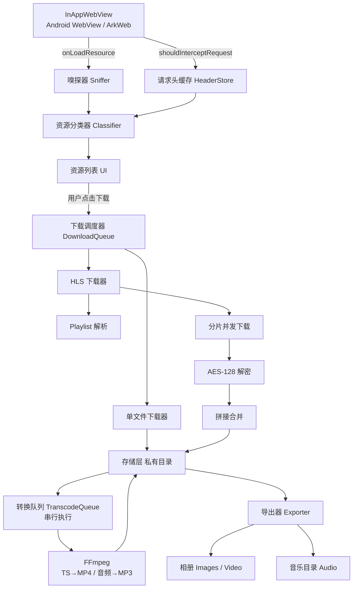

# 媒体嗅探浏览器 — 技术方案

> 状态：草案 v2
> 目标平台：Android、HarmonyOS NEXT、Windows
> 形态：自用工具（不上架）

---

## 1. 项目概述

做一个内置 WebView 的浏览器应用，用户在其中正常浏览网页时，自动收集页面上加载的图片、音频、视频资源，并提供下载能力。对 HLS（m3u8）流媒体，需要解析分片、解密并合并成完整可播放文件。

**核心能力边界**：

| 能力 | 是否支持 |
| --- | --- |
| 图片 / 音频 / 普通视频文件嗅探与下载 | 支持 |
| HLS（m3u8）流媒体合并下载 | 支持 |
| 断点续传、多分片并发 | 支持 |
| TS 转 MP4 | 支持（FFmpeg 无损 remux） |
| 音频转 MP3 | 支持（FFmpeg 重编码，有损） |
| DASH（mpd） | 有限支持，仅完整分片 |
| Widevine / FairPlay 等 DRM 内容 | 不支持 |
| 签名参数保护的平台（YouTube、B 站等） | 不支持 |

---

## 2. 可行性结论

### 2.1 Flutter 支持鸿蒙的现状

Flutter 官方主线的 `flutter` 仓库中没有 `ohos` 平台目录，鸿蒙支持由 **OpenHarmony Flutter SIG** 维护（隶属跨平台框架 PMC），载体是 `CPF-Flutter` 组织的 Flutter 引擎分支与插件仓库。

时间线：

| 时间 | 事件 |
| --- | --- |
| 2026-01 | OpenHarmony 正式成立 Flutter SIG 工作组，官方授牌 |
| 2026-03 | 发布 Flutter 3.35 Release，全量对齐上游特性 |
| 2026-06 | AtomGit 建立 CPF-Flutter 组织，124 个三方插件库集中迁移 |
| 2026-09-30 | 发布 `3.41.9+ohos-1.0.2`（Dart 3.11.5） |
| 2026-10-21 | `3.47.7` 先锋版放出（实验性） |

当前维护版本线：`3.7.12 / 3.22.3 / 3.27.4 / 3.35.7 / 3.41.9`。三方库官方适配 300+，生态总量 4.4 万，与上游版本间隔从 7 个月缩短到 4 个月。

生态分工：

- **CPF-Flutter** — 主干道，框架、引擎、大厂官方插件
- **oh-flutter** — 高频插件，几乎每日上新
- **hxa-flutter** — 冷门插件扫尾

### 2.2 关键插件验证

`flutter_inappwebview` 是功能最完整的 Flutter WebView 插件，鸿蒙适配版坐标为 `CPF-Flutter/flutter_inappwebview`，分支 `br_v6.1.5_ohos`，TAG `6.1.5-ohos-1.0.0`。

已验证支持的能力：

| API | ohos 支持 | 本项目是否依赖 |
| --- | --- | --- |
| `InAppWebView` / `InAppWebViewController` | 是 | 是 |
| `evaluateJavascript` | 是 | 是 |
| `addJavaScriptHandler` | 是 | 是 |
| `shouldOverrideUrlLoading` | 是 | 否 |
| `shouldInterceptRequest` | 是 | **核心依赖** |
| `onLoadResource` | 是 | **核心依赖** |
| `useShouldInterceptAjaxRequest` | 是 | 可选 |

官方验证环境组合（以 3.35 为例）：

```
Flutter 3.35.8-ohos-0.0.1
SDK 6.0.1 (API 21)
DevEco Studio 6.0.1.260
ROM 6.0.0.120 SP6
```

### 2.3 Windows 端的能力边界

Windows 走 `flutter_inappwebview` 的独立实现包 `flutter_inappwebview_windows`，底层是 Microsoft Edge WebView2。

> **实测补充（阶段 0，2026-11-03）**：主包 `flutter_inappwebview` 6.1.5 的依赖里只有
> `_android` / `_ios` / `_macos`，**不会自动带上 Windows 实现**，必须在 `pubspec.yaml`
> 里显式添加 `flutter_inappwebview_windows: ^0.6.0`，否则 Windows 上 `InAppWebView`
> 直接抛 `UnimplementedError`。
> 另外该插件的构建脚本依赖 **NuGet** 拉取 WebView2 SDK、WIL 和 nlohmann.json，
> 机器上没有 `nuget.exe` 会以 `NUGET-NOTFOUND` 失败，与代码无关。

**成熟度差异**：该实现包当前为 0.5 / 0.6 级别（Android 侧为 1.1.x）。关键能力 `shouldInterceptRequest` 直到 0.5.0 才实现，属于较新的功能。

**嗅探通道可能退化**：移动端采用「`onLoadResource` 主嗅探 + `shouldInterceptRequest` 采请求头」双通道。但 Windows 的 changelog 仅记录实现了 `onLoadResourceWithCustomScheme`，未提及普通 `onLoadResource`。若确实不支持，Windows 只能走 `shouldInterceptRequest` 单通道，每次调用需跨平台通道往返等待，资源密集页面会有额外开销。**需在阶段 0 实测确认。**

**独有能力：CDP**。WebView2 支持 `CallDevToolsProtocolMethodAsync`，可通过 `Network.getResponseBody` 直接获取响应体，从而跳过「拦 URL 再重下」这一轮请求。这是移动端不具备的能力。

代价是需要自写 WebView2 C++ 插件；且有实践反馈指出 CDP 与 WebView2 自带事件均会漏掉部分请求，完整性不如 CEF。**第一版不实现，作为后续增强项记录。**

**存储最简单**：Windows 无相册概念，图片 / 视频 / 音频统一写入文件系统目录，无需 MediaStore 或 photoAccessHelper，省掉整个导出适配层。

### 2.4 结论

一套 Dart 代码可同时产出 APK 与 HAP，**WebView 层不需要双写原生代码**。工作量集中在 Dart 下载引擎，两端天然共享。

---

## 3. 技术选型

### 3.1 版本锁定

**不追 3.41 线。** `flutter_inappwebview` 的鸿蒙适配仅在 `3.7 / 3.22 / 3.35` 三条线验证过（3.27 甚至不在 README 兼容列表内）。选用 3.35 线，是当前「插件验证完整 + 版本不过时」的最优平衡点。

| 组件 | 版本 |
| --- | --- |
| Flutter SDK（鸿蒙） | `3.35.8-ohos-0.0.1` |
| Flutter SDK（Android + Windows） | 官方 `3.35.x` |
| HarmonyOS SDK | `6.0.1 (API 21)` |
| DevEco Studio | `6.0.1.260` |
| flutter_inappwebview | `6.1.5-ohos-1.0.0` |

### 3.2 依赖清单

```yaml
dependencies:
  flutter:
    sdk: flutter

  # WebView —— 鸿蒙分支基于 6.1.5，理论上保留 android/ 与 windows/ 实现，
  # 若成立则一份依赖覆盖三端；否则按平台拆依赖。阶段 0 验证。
  flutter_inappwebview:
    git:
      url: https://gitcode.com/CPF-Flutter/flutter_inappwebview.git
      path: flutter_inappwebview
      ref: br_v6.1.5_ohos

  # 网络与下载
  dio: ^5.7.0

  # 状态管理
  # flutter_riverpod 版本以 pub.dev 最新稳定版为准
  flutter_riverpod: ^3.0.0

  # FFmpeg（Android 侧）。鸿蒙侧走 @ohos/ffmpeg-kit，见 3.4
  ffmpeg_kit_flutter_new: ^4.6.3

  # 路径（鸿蒙有 CPF-Flutter 适配分支）
  path_provider: ^2.1.5
  path: ^1.9.0

  # 纯 Dart 加密，用于 HLS AES-128 解密
  pointycastle: ^3.9.1

  # 权限（鸿蒙适配分支 CPF-Flutter/flutter_permission_handler）
  permission_handler: ^12.0.1

  # 文件导出
  file_picker: ^10.3.8

dev_dependencies:
  flutter_lints: ^5.0.0
```

**平台判定**：`Platform.isOhos` 由 Flutter-OH SDK 提供，官方 Flutter SDK 中不存在。所有平台分支代码必须用条件判断包裹，否则 Android 端编译会报错。

```dart
// lib/core/platform/platform_info.dart
import 'dart:io';

class PlatformInfo {
  static bool get isAndroid => Platform.isAndroid;

  static bool get isOhos {
    // Platform.isOhos 仅存在于 Flutter-OH SDK
    try {
      return Platform.operatingSystem == 'ohos';
    } catch (_) {
      return false;
    }
  }
}
```

### 3.3 状态管理

使用 `flutter_riverpod`。

**关于性能的澄清**：Riverpod 与 Provider 在相同订阅粒度下性能几乎无差异。选 Riverpod 的理由是工程性，不是性能：

- `AsyncValue` 内置 loading / error / data 三态，下载、转换这类异步任务省去大量手写状态机
- 不依赖 `BuildContext`，后台任务与跨页面状态天然安全
- `autoDispose` 自动回收，资源列表这类随页面生灭的状态无需手动清理
- 编译期能发现 provider 误用，而非运行时 assert

**唯一影响流畅度的是订阅粒度，与框架无关。** 以下两条约束必须遵守：

**约束一：高频进度不要走 provider 重建。**

下载进度每 100ms 刷新一次。如果整个列表依赖同一个 state 对象，每次进度变化都会重建整屏。正确做法是让进度用 `ValueNotifier` 单独承载：

```dart
class DownloadTask {
  // 进度独立于 state，避免触发 provider 重建
  final progress = ValueNotifier<double>(0);

  void updateProgress(int received, int total) {
    progress.value = total > 0 ? received / total : 0;
  }
}
```

列表项用 `ValueListenableBuilder` 订阅，只有那一行重绘：

```dart
ValueListenableBuilder<double>(
  valueListenable: task.progress,
  builder: (context, value, _) => LinearProgressIndicator(value: value),
)
```

provider 只在**任务增删**与**状态迁移**（pending→running→success）时更新，进度变化不触发。

**约束二：需要精确订阅用 `select`。**

```dart
// 只关心任务数量，任务内容变化不重建
final count = ref.watch(downloadQueueProvider.select((tasks) => tasks.length));
```

避免 `ref.watch(downloadQueueProvider)` 后取整个列表做计算，那会把无关字段的变化也当依赖。

---

### 3.4 FFmpeg 方案

**为什么必须引入**：mp3 是有损编码格式，系统侧无可用编码器（Android MediaCodec 有 MP3 解码器但无编码器），只有 FFmpeg 带 `libmp3lame`。既然 FFmpeg 必须进来，TS→mp4 的 remux 顺带解决，无需另写 `MediaExtractor`/`MediaMuxer` 原生代码。

#### 两端实现

| 平台 | 方案 | 版本 | 说明 |
| --- | --- | --- | --- |
| Android | `ffmpeg_kit_flutter_new` | 4.6.x（FFmpeg 8.1.2） | 上游 `arthenica/ffmpeg-kit` 已于 2025 年停止维护，此为社区延续 fork，API 完全兼容 |
| HarmonyOS | `@ohos/ffmpeg-kit` | 1.0.1（MIT） | 华为官方「优选三方库」，仓库 `gitcode.com/CPF-ApplicationTPC/ohos_ffmpeg_kit` |
| Windows | `ffmpeg_kit_flutter_new` | 4.6.x | 同一包，提供 x86_64 预编译产物（MSYS2 构建）。**不支持 Windows ARM64** |

鸿蒙侧的关键信息：该库 README 明确写明「作为 `ffmpeg_kit_flutter` 等上层框架的底层支撑层」，且编译依赖包含 **lame**、libogg、libvorbis、dav1d、openh264 等，mp3 编码能力齐备。验证环境为 DevEco Studio 6.0.0 Release + SDK API 20 + ROM 6.0.0.130。

#### 常用命令

```bash
# TS → MP4：无损转封装，不重编码，秒级完成
ffmpeg -i input.ts -c copy output.mp4

# 任意音频 → MP3：重编码，有损
ffmpeg -i input.m4a -c:a libmp3lame -b:a 192k output.mp3

# 探测媒体信息（用于判断编码、时长、是否需要转封装）
ffprobe -v quiet -print_format json -show_format -show_streams input.ts
```

#### 依赖隔离问题

`ffmpeg_kit_flutter_new` 只声明 Android / iOS / macOS / Windows / Linux，不含 ohos。而 Dart 不支持按平台条件依赖。三种处理路径，按优先级：

1. **首选**：确认 CPF-ApplicationTPC 组织下是否有同时包含 `android/` 与 `ohos/` 目录的 `ffmpeg_kit_flutter` fork。若有，一处 git 依赖双端通吃，最省事。
2. **次选**：两套依赖并存，Android 构建时忽略 ohos 包、ohos 构建时忽略 Android 包，靠构建脚本切换 `pubspec.yaml`。
3. **兜底**：Dart 侧只依赖一层自建的 `FfmpegRunner` 抽象（MethodChannel），原生侧各自调用对应库，Dart 包依赖用 `--no-ffmpeg` 之类的构建开关剥离。

**这一项标注为阶段 4 的首要验证点**，因为它决定依赖管理方式，越早确认越好。

#### 执行约束

- **必须串行**。华为官方文档明确：批量 FFmpeg 任务并行只会让每个都变慢，还可能触发内存压力。转换队列需保证同一时刻只有一个 session 在跑。
- 转码是 CPU 密集型，禁止在主线程同步执行。`ffmpeg-kit` 的 session 本身是异步的，但不要在等待期间做轮询阻塞。
- 每个 session 支持取消，转换队列需要基于 sessionId 实现「取消」按钮。
- 转 mp4 用 `-c copy` 时，若源流编码不被 MP4 容器支持（如某些 AAC 变体、AC-3），需要回退到重编码。先跑 `ffprobe` 判断，避免直接失败。

## 4. 系统架构



分层：

| 层 | 职责 | 平台相关性 |
| --- | --- | --- |
| Presentation | 浏览器页、资源面板、下载列表 | 无 |
| Domain | 媒体模型、分类规则、下载用例 | 无 |
| Data | 下载器、解析器、存储仓储 | 部分 |
| Platform | 权限、存储导出、路径 | 强 |

---

## 5. 模块设计

### 5.1 嗅探层

#### 双回调策略

`flutter_inappwebview` 提供两个相关回调，用途不同，必须组合使用：

| 回调 | 能拿到 | 开销 | 用途 |
| --- | --- | --- | --- |
| `onLoadResource` | URL、MIME、contentLength | 低（纯通知） | 主嗅探通道 |
| `shouldInterceptRequest` | URL、method、**请求头** | 高（需跨平台通道往返并等待返回） | 采集请求头，供下载复用 |

**不要用 `shouldInterceptRequest` 做主嗅探。** 它每次调用都会阻塞 WebView 的资源加载，等待 Dart 侧返回。页面资源多时会明显卡顿。

**但请求头必须从它拿。** 这是实战中最容易踩的坑：嗅探到的 URL 直接下载，大概率返回 403 —— 因为缺少 `Referer` 和 `User-Agent`。很多站点的 CDN 会校验 Referer。

#### 实现骨架

```dart
// lib/features/sniffer/data/sniffer_service.dart
class SnifferService {
  final Map<String, Map<String, String>> _headerCache = {};
  final _detected = <String, MediaItem>{};

  InAppWebViewSettings get settings => InAppWebViewSettings(
        useOnLoadResource: true,
        useShouldInterceptRequest: true,
        mediaPlaybackRequiresUserGesture: false,
        javaScriptEnabled: true,
        domStorageEnabled: true,
        // 注意：鸿蒙适配版 transparentBackground 的 PR 未合入，不要设 true
      );

  /// 采集请求头，不做拦截（始终返回 null 放行）
  Future<WebResourceResponse?> onInterceptRequest(
    InAppWebViewController controller,
    WebResourceRequest request,
  ) async {
    final url = request.url.toString();
    if (MediaClassifier.looksLikeMedia(url)) {
      _headerCache[url] = Map<String, String>.from(request.headers);
    }
    return null; // 放行，不改变加载行为
  }

  /// 主嗅探通道
  void onLoadResource(InAppWebViewController controller, LoadedResource resource) {
    final item = MediaClassifier.classify(
      url: resource.url.toString(),
      mimeType: resource.mimeType,
      contentLength: resource.contentLength,
    );
    if (item == null) return;
    if (_detected.containsKey(item.url)) return;

    item.headers = _headerCache[item.url] ?? {};
    _detected[item.url] = item;
    _emit(item);
  }
}
```

#### 请求头补全

下载时按以下优先级构造 headers：

1. `_headerCache` 中缓存的原始请求头
2. WebView 的 Cookie：`CookieManager.instance().getCookies(url)`
3. 兜底 `User-Agent`（与 WebView 设置的一致）
4. 同源页面的 `Referer`

```dart
Future<Map<String, String>> buildDownloadHeaders(MediaItem item) async {
  final headers = <String, String>{...item.headers};
  final cookies = await CookieManager.instance().getCookies(url: WebUri(item.url));
  if (cookies.isNotEmpty) {
    headers['Cookie'] = cookies.map((c) => '${c.name}=${c.value}').join('; ');
  }
  headers.putIfAbsent('User-Agent', () => _ua);
  if (item.referer != null) headers.putIfAbsent('Referer', () => item.referer!);
  return headers;
}
```

### 5.2 资源分类

MIME 和扩展名双重判断，MIME 优先但不完全可信（m3u8 的 MIME 可能是 `application/vnd.apple.mpegurl`、`application/x-mpegURL` 或 `text/plain`）。

```dart
enum MediaType { image, audio, video, hls, dash }

class MediaClassifier {
  static final _extMap = {
    '.jpg': MediaType.image, '.jpeg': MediaType.image, '.png': MediaType.image,
    '.webp': MediaType.image, '.gif': MediaType.image, '.avif': MediaType.image,
    '.mp3': MediaType.audio, '.m4a': MediaType.audio, '.aac': MediaType.audio,
    '.flac': MediaType.audio, '.ogg': MediaType.audio, '.wav': MediaType.audio,
    '.mp4': MediaType.video, '.webm': MediaType.video, '.mkv': MediaType.video,
    '.mov': MediaType.video,
    '.m3u8': MediaType.hls,
    '.mpd': MediaType.dash,
  };

  static MediaType? classify({
    required String url,
    String? mimeType,
    int? contentLength,
  }) {
    if (url.startsWith('data:') || url.startsWith('blob:')) return null;
    if (_isTracker(url)) return null;

    final path = Uri.tryParse(url)?.path.toLowerCase() ?? '';
    final ext = path.contains('.') ? path.substring(path.lastIndexOf('.')) : '';

    // m3u8 优先按扩展名判定，MIME 不可靠
    if (ext == '.m3u8') return MediaType.hls;
    if (ext == '.mpd') return MediaType.dash;

    final mime = mimeType?.toLowerCase() ?? '';
    if (mime.contains('mpegurl')) return MediaType.hls;
    if (mime.startsWith('image/')) return MediaType.image;
    if (mime.startsWith('audio/')) return MediaType.audio;
    if (mime.startsWith('video/')) return MediaType.video;

    return _extMap[ext];
  }

  static bool looksLikeMedia(String url) { /* 轻量后缀匹配，用于请求头缓存 */ }

  static bool _isTracker(String url) {
    const blocked = ['/analytics', '/beacon', '/track', '/pixel', '/log?'];
    return blocked.any(url.contains);
  }
}
```

过滤规则：

- 丢弃 `data:`、`blob:` 协议（`blob:` 是 MSE 动态拼流，抓不到原始分片）
- 丢弃统计埋点
- 可选：丢弃小于 1KB 的图片（通常是占位图、埋点像素）
- 可选：按域名分组展示，避免同一 CDN 刷屏

### 5.3 单文件下载

```dart
class FileDownloader {
  Future<void> download(MediaItem item, CancelToken token, {void Function(int, int)? onProgress}) async {
    final headers = await buildDownloadHeaders(item);
    await dio.download(
      item.url,
      item.localPath,
      cancelToken: token,
      options: Options(
        headers: headers,
        followRedirects: true,
        receiveTimeout: const Duration(minutes: 5),
      ),
      onReceiveProgress: onProgress,
    );
  }
}
```

要点：

- 支持 `Range` 断点续传，记录已下载字节数
- 并发上限 3（自用场景，避免被 CDN 限流）
- 失败重试 3 次，指数退避
- 文件名从 URL 的 path 取，冲突时追加 `_1`、`_2`

### 5.4 HLS 下载

这是整个项目最复杂的模块，拆成四步。

#### 步骤一：解析 Playlist

```dart
class M3u8Parser {
  /// 返回 true 表示是 master playlist（多码率）
  static bool isMaster(String content) => content.contains('#EXT-X-STREAM-INF');

  /// master 解析：返回所有 variant 的 URL 与带宽
  static List<M3u8Variant> parseVariants(String content, Uri baseUri) { ... }

  /// media 解析：返回分片列表
  static M3u8MediaPlaylist parseMedia(String content, Uri baseUri) {
    final segments = <M3u8Segment>[];
    int mediaSequence = 0;
    M3u8Key? currentKey;
    String? mapUri;
    int byteRangeOffset = 0;

    for (final line in const LineSplitter().convert(content)) {
      final l = line.trim();
      if (l.startsWith('#EXT-X-MEDIA-SEQUENCE:')) {
        mediaSequence = int.parse(l.split(':')[1]);
      } else if (l.startsWith('#EXT-X-KEY:')) {
        currentKey = M3u8Key.parse(l, baseUri);
      } else if (l.startsWith('#EXT-X-MAP:')) {
        mapUri = _extractUri(l, baseUri);
      } else if (l.startsWith('#EXTINF:')) {
        // 记录 duration，分片 URL 在下一行
      } else if (l.isNotEmpty && !l.startsWith('#')) {
        segments.add(M3u8Segment(
          uri: baseUri.resolve(l),
          sequence: mediaSequence + segments.length,
          key: currentKey,
          byteRange: byteRangeOffset,
        ));
      }
    }
    return M3u8MediaPlaylist(segments: segments, initSegmentUri: mapUri);
  }
}
```

关键点：

- **相对路径必须基于 playlist 自身的 URL 解析**，不能基于页面 URL。CDN 的分片路径经常是 `./seg-1.ts` 这种相对形式
- `#EXT-X-MAP` 是 fMP4 的初始化段，必须放在合并结果的最前面
- `#EXT-X-BYTERANGE` 表示多个分片在同一个文件里，需要按字节范围请求

#### 步骤二：码率选择

master playlist 里有多个 `#EXT-X-STREAM-INF`，按 `BANDWIDTH` 降序取最高，同时过滤掉不支持的编码（如 `CODECS="av01..."` 可能设备不支持解码，但下载不影响）。

UI 上建议让用户手动选清晰度，默认最高。

#### 步骤三：AES-128 解密

这是最容易出错的地方。

```dart
#EXT-X-KEY:METHOD=AES-128,URI="https://cdn.example.com/key.bin",IV=0x1a2b3c...
```

规则：

- `METHOD=NONE` 表示不加密
- `IV` 存在时直接用它（16 字节）
- **IV 缺省时，使用媒体序列号（media sequence number）作为 IV**，编码为 16 字节大端整数。用错会导致解密后全是乱码
- 解密算法：AES-128-CBC
- padding：HLS 分片通常有 PKCS7 padding，但部分源无 padding，解密后需要检测并容忍

```dart
class AesDecryptor {
  static Uint8List decrypt({
    required Uint8List key,
    required Uint8List iv,
    required Uint8List data,
  }) {
    final cipher = CBCBlockCipher(AESEngine())
      ..init(false, ParametersWithIV(KeyParameter(key), iv));
    final out = Uint8List(data.length);
    for (var i = 0; i < data.length; i += 16) {
      cipher.processBlock(data, i, out, i);
    }
    // 先去 padding，再判断是否为合法 PKCS7，非法则原样返回
    return _stripPkcs7(out);
  }

  /// IV 缺省时用序列号构造
  static Uint8List ivFromSequence(int sequence) {
    final iv = Uint8List(16);
    final bd = ByteData.view(iv.buffer);
    bd.setUint64(8, sequence); // 高 8 字节为 0，低 8 字节为序列号
    return iv;
  }
}
```

key 文件本身也要带请求头请求（有些站点对 key 单独校验），并且**缓存**，不要每个分片都拉一次。

#### 步骤四：分片下载与合并

```dart
class HlsDownloader {
  Future<void> download(M3u8MediaPlaylist playlist, MediaItem item, CancelToken token) async {
    final tmpDir = await _createTempDir(item);
    final parts = <int, File>{};

    // 并发下载，限流 4
    final pool = Pool(4);
    for (final seg in playlist.segments) {
      pool.withResource(() async {
        final bytes = await _fetchSegment(seg, item.headers, token);
        final data = seg.key == null
            ? bytes
            : AesDecryptor.decrypt(
                key: await _fetchKey(seg.key!, item.headers),
                iv: seg.key!.iv ?? AesDecryptor.ivFromSequence(seg.sequence),
                data: bytes,
              );
        final f = File('${tmpDir.path}/${seg.sequence}.part');
        await f.writeAsBytes(data);
        parts[seg.sequence] = f;
      });
    }
    await pool.close();

    // 顺序合并
    await _merge(playlist, parts, item.localPath);
  }
}
```

合并策略按分片类型分两种：

| 分片类型 | 识别方式 | 合并方式 | 输出 |
| --- | --- | --- | --- |
| TS | 后缀 `.ts`，或首字节 `0x47` | 二进制顺序拼接 | `.ts` |
| fMP4 | 存在 `#EXT-X-MAP`，后缀 `.m4s`/`.mp4` | init segment + 各分片拼接 | `.mp4` |

**拼接阶段不需要 FFmpeg。** TS 文件 VLC、PotPlayer、IINA 都能直接播放；fMP4 拼接后就是标准 mp4。

FFmpeg 只在后续的「转封装 / 转码」环节使用（TS→mp4、音频→mp3），见 3.4 与 5.7。

合并时用流式写入，避免把几 GB 内容全部读进内存：

```dart
Future<void> _merge(...) async {
  final sink = File(outputPath).openWrite();
  try {
    if (playlist.initSegmentUri != null) {
      sink.add(await _fetchInitSegment(playlist.initSegmentUri!));
    }
    for (final seg in playlist.segments) {
      sink.add(await parts[seg.sequence]!.readAsBytes());
      await parts[seg.sequence]!.delete();
    }
  } finally {
    await sink.close();
  }
}
```

### 5.5 存储与相册导出

采用**两阶段**策略：下载一律先落到应用私有目录，下载完成后再由用户主动触发导出。这个顺序不只是设计偏好——鸿蒙 SaveButton 的授权窗口只有 10 秒（API ≤19）或 1 分钟（API 20+），官方文档明确要求「不要把网络下载放到获得授权之后才开始」。

#### 阶段划分

| 阶段 | 写入位置 | 失败影响 |
| --- | --- | --- |
| 下载中 | 应用私有目录 | 失败只留临时文件，不影响公共库 |
| 下载完成 | 应用私有目录 | 文件中立可用，可通过「打开方式」预览 |
| 用户导出 | 系统媒体库 / 音乐目录 | 导出失败可重试，源文件不受影响 |

| 平台 | 临时目录 | 下载输出目录 |
| --- | --- | --- |
| Android | `getTemporaryDirectory()` | `getExternalStorageDirectory()/downloads/` |
| HarmonyOS | `context.cacheDir` | `context.filesDir/downloads/` |
| Windows | `getTemporaryDirectory()` | `getDownloadsDirectory()` |

#### 导出目标矩阵

**关键约束：相册只认图片和视频。** 音频进不了相册（两端都一样），TS 容器也不被识别。

| 媒体类型 | 导出目标 | Android 集合 | 鸿蒙接口 | Windows |
| --- | --- | --- | --- | --- |
| 图片 | 相册 | `MediaStore.Images` | `PhotoType.IMAGE` | 文件目录，无需适配 |
| 视频（mp4/mov） | 相册 | `MediaStore.Video` | `PhotoType.VIDEO` | 文件目录，无需适配 |
| 音频（mp3/m4a/flac） | 音乐目录 | `MediaStore.Audio` | 文件目录 / `AudioViewPicker` | 文件目录，无需适配 |
| TS 文件 | **需先转 MP4** | — | — | 需先转 MP4 |

Windows 没有媒体库抽象，「导出」退化为「选择目标文件夹」，实现上比两端都简单——`MediaExporter` 在 Windows 走纯 Dart 的文件复制即可。

TS 的处理见 5.5.4。

#### 5.5.1 Android 实现

API 29+ 使用 MediaStore 的 `IS_PENDING` 机制，**无需任何存储权限**：

```kotlin
// android/app/src/main/kotlin/.../MediaExporter.kt
fun exportToGallery(context: Context, srcFile: File, isVideo: Boolean): String? {
    val collection = if (isVideo) {
        MediaStore.Video.Media.EXTERNAL_CONTENT_URI
    } else {
        MediaStore.Images.Media.EXTERNAL_CONTENT_URI
    }
    val mime = if (isVideo) "video/mp4" else "image/jpeg"
    val values = ContentValues().apply {
        put(MediaStore.MediaColumns.DISPLAY_NAME, srcFile.name)
        put(MediaStore.MediaColumns.MIME_TYPE, mime)
        put(MediaStore.MediaColumns.RELATIVE_PATH,
            if (isVideo) Environment.DIRECTORY_MOVIES else Environment.DIRECTORY_PICTURES)
        put(MediaStore.MediaColumns.IS_PENDING, 1)
    }

    val resolver = context.contentResolver
    val uri = resolver.insert(collection, values) ?: return null

    resolver.openOutputStream(uri)?.use { out ->
        srcFile.inputStream().use { it.copyTo(out) }
    }

    // 必须置回 0，否则该条目对其他应用不可见
    values.clear()
    values.put(MediaStore.MediaColumns.IS_PENDING, 0)
    resolver.update(uri, values, null, null)
    return uri.toString()
}
```

要点：

- `IS_PENDING=1` 的作用是写入期间对其它应用隐藏，避免相册里出现半截文件
- API ≤28 需要 `WRITE_EXTERNAL_STORAGE`，且写入后要用 `MediaScannerConnection.scanFile` 触发索引
- 音频走 `MediaStore.Audio.Media.EXTERNAL_CONTENT_URI`，`RELATIVE_PATH` 用 `Environment.DIRECTORY_MUSIC`

#### 5.5.2 鸿蒙实现

鸿蒙不给 `ohos.permission.WRITE_IMAGEVIDEO`（受限权限，个人开发者难以申请），官方给出的替代路径有两条：

**方案 A：`showAssetsCreationDialog`（推荐）**

纯接口调用，拉起系统保存确认弹窗，用户同意后返回的 uri **永久生效**。不需要安全控件，可以直接在 MethodChannel 里调用。

```typescript
// ohos/entry/src/main/ets/.../MediaExporter.ets
import { photoAccessHelper } from '@kit.MediaLibraryKit';
import { fileIo } from '@kit.CoreFileKit';
import { common } from '@kit.AbilityKit';

async function exportToGallery(
  context: common.UIAbilityContext,
  srcPath: string,
  isVideo: boolean,
): Promise<string[]> {
  const helper = photoAccessHelper.getPhotoAccessHelper(context);
  const fileUri = 'file://' + srcPath;
  const srcFd = fileIo.openSync(fileUri, fileIo.OpenMode.READ_ONLY);

  const options: photoAccessHelper.CreateOptions = {
    title: `sniffed_${Date.now()}`,
  };

  const uris = await helper.showAssetsCreationDialog(
    [fileUri],
    [{
      title: options.title,
      fileNameExtension: isVideo ? 'mp4' : 'jpg',
      photoType: isVideo
        ? photoAccessHelper.PhotoType.VIDEO
        : photoAccessHelper.PhotoType.IMAGE,
    }],
  );

  if (uris.length === 0) {
    fileIo.closeSync(srcFd);
    return []; // 用户取消
  }

  // 按返回的 uri 逐个写入
  const destFd = fileIo.openSync(uris[0], fileIo.OpenMode.READ_WRITE);
  fileIo.copyFileSync(srcFd.fd, destFd.fd);
  fileIo.closeSync(srcFd);
  fileIo.closeSync(destFd);
  return uris;
}
```

> 具体入参签名以设备 SDK 的 d.ts 为准，需真机实测确认前台调用时机限制。

**方案 B：`SaveButton` 安全控件（体验更优，实现更绕）**

用户点击即临时授权，无权限弹窗。约束：

- 授权时长：API ≤19 为 10 秒，API 20+ 为 1 分钟，超时后 `createAsset` 失效
- 只能在应用主窗口 / 子窗口使用，**不支持 UIExtension**
- 必须真实点击，不能代码触发；不能被遮挡、缩小或用普通按钮伪装，否则安全校验失败
- 修改图标文字需要 `ohos.permission.CUSTOMIZE_SAVE_BUTTON`（受限），所以只能用默认样式

因为 Flutter 界面里嵌 ArkUI 安全控件需要 PlatformView，第一版先用方案 A。若后续觉得确认弹窗太打扰，再把 SaveButton 通过 PlatformView 嵌进来。

#### 5.5.3 统一桥接接口

```dart
abstract class MediaExporter {
  Future<ExportResult> exportToGallery(String localPath, MediaType type);
  Future<ExportResult> exportToMusic(String localPath);
}

enum ExportResult { success, canceled, unsupportedFormat, failed }
```

Dart 侧只依赖这个接口，`MethodChannel('sniffing_browser/exporter')` 分别由 Kotlin 与 ArkTS 实现。

#### 5.5.4 TS 文件的处理

相册不接受 `.ts` 容器。因为 FFmpeg 已是项目硬依赖（见 3.4），直接用 remux 解决，不再需要「降级存文件目录」这种妥协方案：

```
下载完成 → 得到 .ts
  → 用户触发「转为 MP4」
  → 转换队列执行 ffmpeg -i in.ts -c copy out.mp4
  → 转换完成，可正常导出到相册
```

`-c copy` 只换容器不重编码，无损，通常数秒完成。

若源是 fMP4 分片（playlist 含 `#EXT-X-MAP`，或分片后缀为 `.m4s` / `.mp4`），拼接结果本身就是 mp4，无需转换，「保存到相册」直接可用。**这也是优先支持 fMP4 路径的理由——它省掉一次转换。**

判断依据：

```dart
bool isFmp4(M3u8MediaPlaylist playlist) =>
    playlist.initSegmentUri != null ||
    playlist.segments.first.uri.path.endsWith('.m4s') ||
    playlist.segments.first.uri.path.endsWith('.mp4');
```

### 5.6 下载队列

```
pending → running → success
                 ↘ failed (可重试)
                 ↘ canceled
```

- 全局最多 3 个任务并发（同一 m3u8 内部再开 4 个分片）
- 任务持久化到本地 JSON，App 重启后可恢复
- 进度通过每个任务独立的 `ValueNotifier` 推给 UI，队列级 notifier 只在任务增删与状态迁移时通知
- m3u8 任务记录已完成的分片序号，支持断点续传

### 5.7 转换队列

统一处理两类后处理，都通过 FFmpeg 完成：

| 类型 | 触发条件 | 命令 |
| --- | --- | --- |
| TS → MP4 | 下载结果为 `.ts` | `-i in.ts -c copy out.mp4` |
| 音频 → MP3 | 用户手动触发，源非 mp3 | `-i in.m4a -c:a libmp3lame -b:a 192k out.mp3` |

#### 执行模型

**必须串行。** 同一时刻只允许一个 FFmpeg session 运行——并行只会让每个都变慢，还可能触发内存压力。队列本身是 FIFO，一次取一个。

```dart
class TranscodeQueue {
  bool _running = false;

  Future<void> _drain() async {
    if (_running) return;
    _running = true;
    try {
      while (_pending.isNotEmpty) {
        final job = _pending.removeAt(0);
        await _runOne(job);   // await 保证串行
      }
    } finally {
      _running = false;
    }
  }

  Future<void> _runOne(TranscodeJob job) async {
    final session = await FFmpegKit.executeAsync(
      job.command,
      (session) async {
        final rc = await session.getReturnCode();
        job.finish(ReturnCode.isSuccess(rc));
      },
      null,
      (log) => job.appendLog(log.getMessage()),
    );
    job.sessionId = session.getSessionId();
  }
}
```

#### 关键设计

**原文件保留。** 转换产出一个新文件，不删除源文件。原因：转码可能失败、参数可能需要重调、用户可能想要原格式。清理交给用户或定期策略。

**转 mp3 是有损操作。** 若源为 m4a/AAC，重编码只会降低音质。因此不设为默认行为，做成用户主动触发的操作，并在 UI 上说明。

**进度来自日志解析。** FFmpeg 输出 `time=00:00:12.34`，用正则抓出来除以总时长即可。总时长通过 `ffprobe` 预先获取。

```dart
final _timePattern = RegExp(r'time=(\d+):(\d+):(\d+)\.(\d+)');
```

**取消要真正中断进程。** 调 `FFmpegKit.cancel(sessionId)`，不是只把 UI 状态标记为取消。

**`-c copy` 可能失败。** 若源流编码不被 MP4 容器支持（AC-3、部分 AAC 变体），remux 会报错。处理方式：先 `ffprobe` 检查音频编码，不在白名单内则改用 `-c:v copy -c:a aac`（只重编音频，比全量重编码快得多）。

#### UI 交互

不做独立页面。转换是下载列表项上的操作：

- 下载完成且是 `.ts` → 显示「转为 MP4」
- 下载完成且音频非 mp3 → 显示「转为 MP3」
- 支持长按多选 → 批量加入转换队列
- 转换中显示进度条与取消按钮
- 转换完成 → 原条目旁出现新条目，或原地更新文件名

这样用户不需要离开列表就能完成全部操作，也避免了「文件在哪个页面」的认知负担。

---

## 6. 数据模型

```dart
class MediaItem {
  final String id;          // url 的 hash
  final String url;
  final MediaType type;
  final String? mimeType;
  final int? contentLength;
  final String? title;      // 从页面提取
  final String? referer;
  final String pageUrl;
  final DateTime detectedAt;
  Map<String, String> headers;
  String? localPath;
}
```

`id` 用 URL 的 MD5，保证同一资源不重复入列。

```dart
class DownloadTask {
  final String id;
  final String mediaId;
  final String url;
  final MediaType type;
  DownloadStatus status;
  int receivedBytes;
  int? totalBytes;
  int segmentDone;      // HLS 专用
  int? segmentTotal;
  String? error;
  final DateTime createdAt;

  // 导出状态与下载状态独立：下载成功不等于已进相册
  ExportStatus exportStatus;
  String? exportedUri;  // 导出成功后系统返回的 uri
}

enum ExportStatus { none, exporting, done, failed, unsupported }

enum TranscodeType { tsToMp4, audioToMp3 }

class TranscodeJob {
  final String id;
  final String sourcePath;
  final String outputPath;
  final TranscodeType type;
  TranscodeStatus status;
  final progress = ValueNotifier<double>(0);
  int? sessionId;        // FFmpeg session id，用于取消
  String? error;

  String get command => switch (type) {
        TranscodeType.tsToMp4 =>
          '-i "$sourcePath" -c copy -y "$outputPath"',
        TranscodeType.audioToMp3 =>
          '-i "$sourcePath" -vn -c:a libmp3lame -b:a 192k -y "$outputPath"',
      };
}

enum TranscodeStatus { pending, running, success, failed, canceled }

class M3u8Segment {
  final Uri uri;
  final int sequence;
  final M3u8Key? key;
  final int? byteRange;
}

class M3u8Key {
  final String method;   // NONE / AES-128
  final Uri? uri;
  final Uint8List? iv;
}
```

---

## 7. 目录结构

```
sniffing-browser/
├── android/                        # Android 平台工程
├── ohos/                           # 鸿蒙平台工程（flutter create --platforms ohos . 生成）
├── windows/                        # Windows 平台工程
├── docs/
│   └── tech-design.md
├── lib/
│   ├── main.dart
│   ├── app.dart
│   ├── core/
│   │   ├── constants/
│   │   │   └── app_constants.dart
│   │   ├── platform/
│   │   │   ├── platform_info.dart
│   │   │   ├── storage_paths.dart
│   │   │   └── media_exporter.dart      # MethodChannel 封装，导出到相册/音乐目录
│   │   └── utils/
│   │       ├── hash_util.dart
│   │       └── format_util.dart
│   ├── features/
│   │   ├── browser/
│   │   │   ├── presentation/
│   │   │   │   ├── browser_page.dart
│   │   │   │   ├── address_bar.dart
│   │   │   │   └── webview_host.dart
│   │   │   └── providers/
│   │   │       └── browser_provider.dart
│   │   ├── sniffer/
│   │   │   ├── domain/
│   │   │   │   ├── media_item.dart
│   │   │   │   ├── media_type.dart
│   │   │   │   └── media_classifier.dart
│   │   │   ├── data/
│   │   │   │   └── sniffer_service.dart
│   │   │   ├── presentation/
│   │   │   │   ├── resource_panel.dart
│   │   │   │   └── resource_tile.dart
│   │   │   └── providers/
│   │   │       └── sniffer_provider.dart
│   │   ├── downloader/
│   │   │   ├── domain/
│   │   │   │   ├── download_task.dart
│   │   │   │   └── download_status.dart
│   │   │   ├── data/
│   │   │   │   ├── download_queue.dart
│   │   │   │   ├── file_downloader.dart
│   │   │   │   └── hls/
│   │   │   │       ├── hls_downloader.dart
│   │   │   │       ├── m3u8_parser.dart
│   │   │   │       ├── m3u8_models.dart
│   │   │   │       ├── aes_decryptor.dart
│   │   │   │       └── segment_merger.dart
│   │   │   ├── presentation/
│   │   │   │   ├── download_page.dart
│   │   │   │   └── download_tile.dart
│   │   │   └── providers/
│   │   │       └── download_provider.dart
│   │   ├── transcode/
│   │   │   ├── domain/
│   │   │   │   └── transcode_job.dart
│   │   │   ├── data/
│   │   │   │   ├── transcode_queue.dart      # 串行执行
│   │   │   │   └── ffmpeg_runner.dart        # FFmpeg 封装与日志解析
│   │   │   └── providers/
│   │   │       └── transcode_provider.dart
│   │   └── library/
│   │       └── presentation/
│   │           └── library_page.dart
│   └── shared/
│       └── widgets/
├── test/
└── pubspec.yaml
```

---

## 8. 实施阶段

### 阶段 0：环境与骨架

- 配置 Flutter SDK（官方版 + 鸿蒙 OH 版），用 fvm 或分离的终端会话隔离 PATH
- `flutter create --platforms ohos .` 补出 `ohos/` 目录
- `flutter config --enable-windows-desktop` 启用 Windows 桌面目标
- DevEco Studio 打开 `ohos/` 配置自动签名
- **Windows 端做最小嗅探验证**：搭一个空壳 WebView2 页面，确认 `shouldInterceptRequest` 能收到回调、`onLoadResource` 是否可用。这决定 Windows 端嗅探层的实现方式
- 验证 `flutter run -d <ohos设备>` 与 `flutter run -d windows` 能跑起 Hello World

**验收**：Android、鸿蒙、Windows 三端各跑起一个空白页；Windows 端完成嗅探回调可用性结论。

### 阶段 1：嗅探

- 接入 `flutter_inappwebview`，实现浏览器外壳（地址栏、前进后退、刷新）
- 实现 `SnifferService` 双回调
- 实现 `MediaClassifier`
- 底部资源面板：按类型分组，显示缩略图、大小、URL

**验收**：打开一个图文页面，能列出全部图片；打开一个视频页，能捕获 m3u8 或 mp4 地址。

### 阶段 2：单文件下载与相册导出

- 请求头补全（Referer / Cookie / UA）
- 下载队列、进度、取消、重试
- 下载列表页
- Android 侧 `MediaExporter`（MediaStore + IS_PENDING），图片与 mp4 导出到相册
- 音频导出到音乐目录
- 按媒体类型决定导出入口是否可见

**验收**：从捕获列表下载一张图和一个 mp4，导出后在系统相册中可见、可播放；音频出现在音乐目录。

### 阶段 3：HLS

按依赖顺序实现：

1. `M3u8Parser` — 先用几个公开测试流验证（Apple 官方测试流、test-streams 仓库）
2. `AesDecryptor` — 单元测试覆盖「有 IV」「无 IV 用序列号」「密钥缓存」
3. `HlsDownloader` — 并发下载 + 断点续传
4. `SegmentMerger` — TS 与 fMP4 两种路径

**验收**：任意 m3u8 链接下载后得到可播放文件，时长与源一致，音画同步。

### 阶段 4：转换能力

- 接入 FFmpeg（Android 侧 `ffmpeg_kit_flutter_new`）
- 封装 `FfmpegRunner`：执行、日志解析进度、取消
- TS → MP4 转换
- 音频 → MP3 转换
- 转换队列（严格串行）
- 下载列表项上的转换入口与批量多选
- 转换完成后与导出流程打通

**验收**：下载一个 TS 源的 m3u8，转为 mp4 后成功保存到相册；下载一个 m4a，转成 mp3 可播放；批量加入 3 个任务时确认是串行执行而非并行。

### 阶段 5：鸿蒙适配

- 切到 Flutter-OH SDK 编译，处理插件依赖的 git 分支
- **解决 FFmpeg 双端依赖隔离**（见 3.4），这是本阶段第一优先项
- 接入 `@ohos/ffmpeg-kit`，验证 mp3 编码与 TS remux 在真机上可用
- 验证 `onLoadResource` / `shouldInterceptRequest` 在 ArkWeb 上的实际行为
- 处理存储路径差异
- 实现 ArkTS 侧 `MediaExporter`：优先 `showAssetsCreationDialog`，实测其前台调用限制
- 若 `showAssetsCreationDialog` 不可用，改用 SaveButton + PlatformView
- 验证已知缺陷的规避（`transparentBackground`、`onReceivedError`）

**验收**：同一份 Dart 代码在鸿蒙真机上完整跑通全部能力——嗅探、单文件下载、m3u8 合并、TS 转 mp4、音频转 mp3、保存到系统相册。

### 阶段 6：Windows 适配

- 按阶段 0 的验证结论实现 Windows 嗅探层（单通道或双通道）
- `MediaExporter` 的 Windows 实现：纯 Dart 文件复制，弹目录选择
- 验证 `ffmpeg_kit_flutter_new` 在 Windows x86_64 上的转码
- 桌面交互适配：右键菜单、拖拽、窗口最小尺寸、快捷键
- 打包为可执行程序

**验收**：Windows 上完成一次完整链路——打开网页、嗅探到 m3u8、下载合并、转 mp4、另存到指定文件夹。

### 阶段 7：打磨

- 页面标题/封面自动提取（`evaluateJavascript` 注入）
- 长按图片直接下载
- 下载完成后分享 / 打开
- 清理临时目录策略

---

## 9. 已知边界与风险

| 风险 | 说明 | 应对 |
| --- | --- | --- |
| DRM 内容 | Widevine / FairPlay 加密流无法解密 | 明确不支持，UI 上给出提示 |
| 签名平台 | YouTube、B 站用签名参数 + 混淆，且分片通过 MSE 拼接 | 放弃，不投入 |
| `blob:` 资源 | MSE 动态拼流，WebView 层拿不到原始分片 | 直接过滤掉，不展示 |
| 403 频发 | 缺 Referer / Cookie / UA | 请求头补全策略，见 5.1 |
| 鸿蒙适配缺陷 | `transparentBackground` 不生效、`onReceivedError` 空指针（PR 未合） | 不使用这两个特性 |
| 版本错配 | Flutter-OH 与插件 TAG 不匹配会导致编译失败 | 严格按 README 的兼容表锁版本 |
| 双 SDK 冲突 | PATH 中先出现的 Flutter 接管所有命令 | fvm 管理，或分离终端 |
| 分片并发过高 | 部分 CDN 对同 IP 并发限流 | 默认 4，可降到 2 |
| 大文件内存 | 数 GB 的流一次性读入会 OOM | 合并必须流式写入 |
| 音频进不了相册 | 两端相册均不显示音频，鸿蒙 Media Library Kit 只处理 image/video | 音频单独走音乐目录，UI 上区分导出目标 |
| TS 需转封装 | 相册不识别 `.ts` 容器 | FFmpeg `-c copy` remux，无损且快；fMP4 源无需此步 |
| FFmpeg 双端依赖隔离 | `ffmpeg_kit_flutter_new` 不支持 ohos，而 Dart 无条件依赖语法 | 阶段 5 首要验证项，见 3.4 的三条路径 |
| 转码发热耗电 | 音频转 mp3 是重编码，长音频耗时明显 | 严格串行，不设为默认行为，UI 明示 |
| mp3 有损 | 源为 AAC 时重编码必然降质 | 保留原文件，转 mp3 由用户主动触发 |
| WebView2 插件成熟度 | `flutter_inappwebview_windows` 仅 0.5/0.6，`shouldInterceptRequest` 0.5.0 才支持 | 阶段 0 先做最小验证，嗅探失败则评估自写 WebView2 插件 |
| Windows 嗅探通道退化 | 可能不支持 `onLoadResource`，只能走 `shouldInterceptRequest` 单通道 | 实测确认；必要时降低回调频率，仅对媒体后缀做处理 |
| Windows ARM64 | `ffmpeg_kit_flutter_new` 仅提供 x86_64 产物 | 不考虑 ARM 设备；如需支持需自行交叉编译 FFmpeg |
| 鸿蒙导出授权窗口 | SaveButton 授权仅 10 秒 / 1 分钟，超时 `createAsset` 失效 | 先下载完成再导出，禁止在授权后才开始网络请求 |

**合规说明**：本工具仅供下载用户有权访问的内容，使用者需自行确保不侵犯版权及违反站点服务条款。

---

## 10. 参考资料

- Flutter-OH 仓库：`https://atomgit.com/openharmony-tpc/flutter_flutter`
- CPF-Flutter 组织：`https://gitcode.com/CPF-Flutter`
- 三方库适配总览：`https://gitcode.com/CPF-Flutter/docs/blob/main/ThirdpartyLibrarites.md`
- flutter_inappwebview 鸿蒙适配：`https://gitcode.com/CPF-Flutter/flutter_inappwebview`
- ArkWeb 请求拦截文档：华为开发者联盟 — Web 组件事件 `onInterceptRequest`
- HLS 规范：RFC 8216
