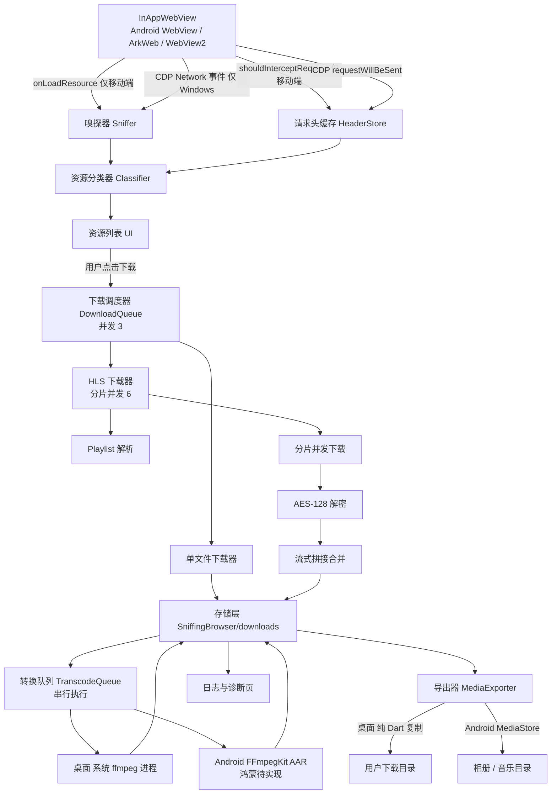

# 媒体嗅探浏览器 — 技术方案

> 状态：实现同步版（2026-11-12 校准，原始设计稿为 v2）
> 目标平台：Android、HarmonyOS NEXT、Windows
> 形态：自用工具（不上架）
>
> 本文保留设计推演与实测记录。2026-11-11 已按实际代码校准版本、依赖、状态管理、
> FFmpeg、数据模型、目录结构与实施阶段状态。**实现事实以 `README.md`、`pubspec.yaml`
> 与 `lib/` 代码为准**；标注「设计」「待实现」「阶段验收」的内容是计划，不是现状。

---

## 0. 当前实现状态（2026-11-12 更新）

| 端 | 状态 |
| --- | --- |
| Windows | 首发基线。嗅探 → 队列 → 下载 → 分片合并 → 转码 mp4 / mp3 已端到端实测 |
| Android | 嗅探双回调已在 USB 真机验收（A2：85 / 83）；MediaStore 导出、原生 FFmpegKit 转码已实现（2026-11-12），待真机跑通导出 / 转 MP3 |
| HarmonyOS NEXT |  sniffing 侧同 Android；`ohos/` 平台目录尚未生成（需 Flutter-OH SDK + DevEco Studio） |

**已落地**：CDP 嗅探（Windows）、移动端双回调嗅探、资源分类与内容校验、
并发下载队列、HLS（master 选码率 / AES-128 / fMP4 init 段 / 分片级续传 / 流式合并）、
DASH 音视频自动配对与合并、桌面系统 ffmpeg 转码、日志与诊断页、桌面纯 Dart 导出、
Android MediaStore 导出、Android 原生 FFmpegKit 转码（TS→MP4 / 抽 MP3 / 合并音视频）、
转换任务独立页面与持久化（`transcode_jobs.json`）、下载记录持久化
（`download_tasks.json`，2026-11-12）。

**未落地**：鸿蒙原生导出与 FFmpeg、单文件字节级续传、MPD 分片重组、鸿蒙平台工程。
详见 `README.md`「未实现」。

**范围变更（2026-11-12）**：用户在 Android USB 真机上跑，明确要求补齐下载完成后的
「导出」与「转 MP3」。8.0 原本定的「A 用例全绿才启动移动端原生导出 / FFmpeg」门槛
由用户决定提前解除，改用原生 AAR 方案落地（见 3.4、5.5）。A1 / A3~A6 仍未验收。

---

## 1. 项目概述

做一个内置 WebView 的浏览器应用，用户在其中正常浏览网页时，自动收集页面上加载的图片、音频、视频与 HLS / DASH 分片，提供下载、合并、转码与导出。

**核心能力边界**（「实现」列以 2026-11-11 代码为准）：

| 能力 | 是否支持 | 实现 |
| --- | --- | --- |
| 图片 / 音频 / 普通视频文件嗅探与下载 | 支持 | 已落地，Windows 实测 |
| HLS（m3u8）流媒体合并下载 | 支持 | 已落地，端到端测试覆盖 |
| 分片级续传、多分片并发 | 支持 | 任务并发 3、分片并发 6；单文件字节级续传未实现 |
| TS 转 MP4 | 支持（FFmpeg 无损 remux） | 桌面已实测；Android 走原生 FFmpegKit，待真机验证 |
| 音频转 MP3 | 支持（FFmpeg 重编码，有损） | 桌面已实测；Android 走原生 FFmpegKit 的 libmp3lame，待真机验证 |
| DASH（mpd）分片重组 | 不支持 | 不解析 MPD；仅嗅探到的完整 `.m4s` 分片可下载，并自动配对音视频合并，见 5.8 |
| 导出到系统相册 / 音乐目录 | 支持 | 桌面纯 Dart 文件复制；Android MediaStore（`IS_PENDING`）；鸿蒙未实现 |
| Widevine / FairPlay 等 DRM 内容 | 不支持 | — |
| 签名参数保护的平台（YouTube 等） | 不支持 | B 站的 `.m4s` 是普通 HTTP 请求，属例外，见 5.8 |

---

## 2. 可行性结论

### 2.1 Flutter 支持鸿蒙的现状

Flutter 官方主线的 `flutter` 仓库中没有 `ohos` 平台目录，鸿蒙支持由 **OpenHarmony Flutter SIG** 维护（隶属跨平台框架 PMC），载体是 `CPF-Flutter` 组织的 Flutter 引擎分支与插件仓库。

时间线：

| 时间 | 事件 |
| --- | --- |
| 2026-01 | OpenHarmony 正式成立 Flutter SIG 工作组，官方授牌 |
| 2026-03 | 发布 Flutter 3.35 Release，全量对齐上游特性 |
| 2026-06 | AtomGit 建立 CPF-Flutter 组织，124 个三方插件库集中迁移 |
| 2026-09-30 | 发布 `3.41.9+ohos-1.0.2`（Dart 3.11.5） |
| 2026-10-21 | `3.47.7` 先锋版放出（实验性） |

当前维护版本线：`3.7.12 / 3.22.3 / 3.27.4 / 3.35.7 / 3.41.9`。三方库官方适配 300+，生态总量 4.4 万，与上游版本间隔从 7 个月缩短到 4 个月。

生态分工：

- **CPF-Flutter** — 主干道，框架、引擎、大厂官方插件
- **oh-flutter** — 高频插件，几乎每日上新
- **hxa-flutter** — 冷门插件扫尾

### 2.2 关键插件验证

`flutter_inappwebview` 是功能最完整的 Flutter WebView 插件，鸿蒙适配版坐标为 `CPF-Flutter/flutter_inappwebview`，分支 `br_v6.1.5_ohos`，TAG `6.1.5-ohos-1.0.0`。

已验证支持的能力。注意 **`shouldInterceptRequest` / `onLoadResource` 两行只适用于 Android / 鸿蒙**，
Windows 上这两个回调不可用，嗅探改走 CDP（见 2.3）：

| API | ohos 支持 | 本项目是否依赖 |
| --- | --- | --- |
| `InAppWebView` / `InAppWebViewController` | 是 | 是 |
| `evaluateJavascript` | 是 | 是（自动播放兜底、媒体治理、读取页面点击） |
| `addJavaScriptHandler` | 是 | 是（`sb_open_tab` 新页签、`sb_user_tap` 收键盘） |
| `shouldOverrideUrlLoading` | 是 | **仅移动端**：拦非 http 协议跳转 + 判定可疑跳转（见 8.0「可疑跳转隔离」）；Windows 侧不启用 |
| `shouldInterceptRequest` | 是 | **核心依赖（仅移动端）**；Windows 侧不用 |
| `onLoadResource` | 是 | **核心依赖（仅移动端）**；Windows 侧不存在 |
| `useShouldInterceptAjaxRequest` | 是 | 否 |

官方验证环境组合（以 3.35 为例）：

```
Flutter 3.35.8-ohos-0.0.1
SDK 6.0.1 (API 21)
DevEco Studio 6.0.1.260
ROM 6.0.0.120 SP6
```

### 2.3 Windows 端的能力边界

Windows 走 `flutter_inappwebview` 的独立实现包 `flutter_inappwebview_windows`，底层是 Microsoft Edge WebView2。

> **实测补充（阶段 0，2026-11-03）**：主包 `flutter_inappwebview` 6.1.5 的依赖里只有
> `_android` / `_ios` / `_macos`，**不会自动带上 Windows 实现**，必须在 `pubspec.yaml`
> 里显式添加 `flutter_inappwebview_windows: ^0.6.0`，否则 Windows 上 `InAppWebView`
> 直接抛 `UnimplementedError`。
> 另外该插件的构建脚本依赖 **NuGet** 拉取 WebView2 SDK、WIL 和 nlohmann.json，
> 机器上没有 `nuget.exe` 会以 `NUGET-NOTFOUND` 失败，与代码无关。

**成熟度差异**：该实现包当前为 0.6 级别（Android 侧为 1.1.x）。

**嗅探通道：移动端那套在 Windows 上不可用，必须换 CDP。**

这条是实测结论，不是推测。读 `flutter_inappwebview_windows` 0.6.0 的 C++ 源码并实际运行后确认：

1. **`onLoadResource` 根本不存在。** 原生侧只注册了 `onLoadResourceWithCustomScheme`，
   从来没有读取过 `useOnLoadResource` 这个设置。文档早期写的「双通道兜底」在 Windows
   上是假的，实际只剩一条通道。
2. **剩下的那条 `shouldInterceptRequest` 会阻塞页面。** 插件注册的是：

   ```cpp
   AddWebResourceRequestedFilter(L"*", COREWEBVIEW2_WEB_RESOURCE_CONTEXT_ALL)
   ```

   通配符 + 全资源类型。每个请求进来都先 `GetDeferral()` 挂起，再 `InvokeMethod` 到
   Dart，**必须等 Dart 回话才 `deferral->Complete()` 放行**。打开一个普通首页有两三百
   个请求，全部串行排队等 Flutter 主 isolate 逐个处理，而主 isolate 同时在跑渲染 ——
   表现就是页面卡死、窗口无响应。

因此 Windows 端的嗅探只能用 **CDP 事件推送**：

| 通道 | 用途 | 是否阻塞 |
| --- | --- | --- |
| `Network.responseReceived` | 发现资源（url + mimeType + 资源类型） | 否 |
| `Network.requestWillBeSent` | 采集请求头（Referer / Cookie，下载必需） | 否 |

插件初始化时已经默认执行了 `Network.enable`，`addDevToolsProtocolEventListener`
也有原生实现，所以这条路不需要写 C++ 插件。代码见 `lib/features/sniffer/data/cdp_sniffer.dart`。

**代价**：CDP 事件不给响应体。但本项目本来就走「拿到 URL 自己重新请求」的路线，没有损失。
`getResponseBody` 可以作为后续增强（插件已暴露 `callDevToolsProtocolMethod`，能直接调），
用来处理需要签名参数、二次请求拿不到的地址。**第一版不做。**

**存储最简单**：Windows 无相册概念，图片 / 视频 / 音频统一写入文件系统目录，无需 MediaStore 或 photoAccessHelper，省掉整个导出适配层。

### 2.4 Windows 插件的崩溃缺陷（实测确认）

`flutter_inappwebview_windows` 0.6.0 的 `PermissionRequestCallback` 解码函数
（`windows/in_app_webview/webview_channel_delegate.cpp:57`）**缺少 null 检查**：

```cpp
// 缺陷写法
decodeResult = [](const flutter::EncodableValue* value) {
  return std::make_shared<PermissionResponse>(std::get<flutter::EncodableMap>(*value));
};

// 同一文件里相邻的 ShouldInterceptRequestCallback 就是对的
return value == nullptr || value->IsNull() ? ... : ...;
```

Dart 侧不提供 `onPermissionRequest` 时，插件收到的是 null，`*value` 就是空指针，
`std::variant::index()` 读偏移 0x40 触发访问违规（`0xc0000005`），**整个进程闪退**。

**影响面**：任何申请权限的网站都会触发。实测 `bing.com` 不申请所以正常，
`juejin.cn` 申请 `OTHER_SENSORS` 必然崩溃。这个 bug 与嗅探通道无关——把 CDP 和
错误回调全关掉仍然照崩，只有定位到权限回调才解释得通。

**规避方式**（已在 `webview_host.dart` 实现）：Dart 侧接管 `onPermissionRequest`，
**永远返回一个有效的 `PermissionResponse`**，不要返回 null，本项目一律 `DENY`。

**定位方法**：Dart 侧日志和错误捕获看不到原生崩溃。为此在
`windows/runner/main.cpp` 装了 `SetUnhandledExceptionFilter` + `MiniDumpWriteDump`，
崩溃时在 exe 同目录生成 `crash_<时间戳>.dmp`，再用 `llvm-symbolizer` 结合构建出来的
`.pdb` 符号化，就能拿到精确到源码行的调用栈。这套机制保留在生产构建里。

### 2.5 结论

一套 Dart 代码可同时产出 APK 与 HAP，**WebView 层不需要双写原生代码**。工作量集中在 Dart 下载引擎，两端天然共享。

---

## 3. 技术选型

### 3.1 版本锁定

**两条版本线并行，不把日常开发锁死在 3.35。** `flutter_inappwebview` 的鸿蒙适配仅在
`3.7 / 3.22 / 3.35` 三条线验证过（3.27 甚至不在 README 兼容列表内），所以鸿蒙构建选
3.35 线；日常开发与 Android / Windows 构建用本机已有的官方 Flutter 3.44.9。
`pubspec.yaml` 的 Dart SDK 约束写成 `>=3.9.0 <4.0.0`，两条线都能满足。

| 组件 | 版本 / 约束 | 用途 |
| --- | --- | --- |
| Dart SDK（`pubspec.yaml`） | `>=3.9.0 <4.0.0` | 兼容 3.35 线（Dart 3.9）与 3.44 线（Dart 3.12） |
| 官方 Flutter | 3.44.9（本机已装） | 日常开发、Android、Windows |
| Flutter-OH | 3.35.8-ohos | 仅鸿蒙构建，需 DevEco Studio |
| HarmonyOS SDK | `6.0.1 (API 21)` | 插件官方验证环境 |
| DevEco Studio | `6.0.1.260` | 同上 |
| `flutter_inappwebview` | `^6.1.5`（pub 稳定版） | 日常开发 |
| `flutter_inappwebview` 鸿蒙分支 | `br_v6.1.5_ohos`（TAG `6.1.5-ohos-1.0.0`） | 鸿蒙构建时按 `pubspec.yaml` 末尾注释替换 |
| `flutter_inappwebview_windows` | `^0.6.0` | Windows 必须显式引入，见 2.3 |

切鸿蒙时把 `flutter_inappwebview` 换成 CPF-Flutter 的 git 依赖，再执行
`flutter clean && flutter pub get`。该 fork 保留 `android/` 与 `windows/` 目录，
**一份依赖覆盖三端，不需要按平台拆依赖**（阶段 0 的这项验证已有结论）。
`ohos/` 平台目录目前仍未生成。

### 3.2 依赖清单

以下为**实际 `pubspec.yaml`**（2026-11-11）：

```yaml
dependencies:
  flutter:
    sdk: flutter
  flutter_riverpod: ^2.6.1
  flutter_inappwebview: ^6.1.5
  flutter_inappwebview_windows: ^0.6.0   # Windows 必需，见 2.3
  dio: ^5.7.0
  path_provider: ^2.1.5
  path: ^1.9.0
  crypto: ^3.0.6                          # 缓存 key / 文件名去重
  pointycastle: ^3.9.1                   # HLS AES-128-CBC 解密

dev_dependencies:
  flutter_test:
    sdk: flutter
  flutter_lints: ^6.0.0
```

**与早期草案的差异**：`flutter_riverpod` 用 2.6 线（不是 3.0）；
`ffmpeg_kit_flutter_new`、`permission_handler`、`file_picker` **均未引入**——
桌面转码调系统 ffmpeg 进程，Android 转码在 `android/app` 引原生 AAR 走
`TranscodeEngine` 抽象（Dart 侧仍无 FFmpeg pub 包，见 3.4），
桌面导出是纯 Dart 文件复制、Android 导出走 MediaStore `IS_PENDING`，
两者都不需要权限与文件选择插件。
`flutter_inappwebview` 日常用 pub 稳定版，git 写法只在鸿蒙构建时按文件末尾注释替换。

**平台判定**：不使用 `Platform.isOhos`（Flutter-OH SDK 专属，官方 SDK 里编译不过）。
实际按 `Platform.operatingSystem` 字符串分支，并带 `dart:io` 可用性兜底，
见 `lib/core/platform/platform_info.dart`：

```dart
enum AppPlatform { android, ohos, windows, macos, linux, other }

class PlatformInfo {
  static AppPlatform get current {
    if (!_isDartIoAvailable) return AppPlatform.other;
    switch (Platform.operatingSystem) {
      case 'android': return AppPlatform.android;
      case 'ohos':    return AppPlatform.ohos;
      case 'windows': return AppPlatform.windows;
      // macos / linux / other 同理
    }
  }

  static bool get isDesktop => ...;   // windows / macos / linux
  static bool get isMobile  => ...;   // android / ohos
  static bool get isWindowsDesktop => current == AppPlatform.windows;

  static bool get _isDartIoAvailable {
    try { Platform.operatingSystem; return true; } catch (_) { return false; }
  }
}
```

`current` 结果会缓存。所有平台分支统一走 `PlatformInfo`，功能层不直接写 `Platform.isXxx`；
这样切到 Flutter-OH SDK 时不需要改业务代码。

### 3.3 状态管理

使用 `flutter_riverpod` 2.6.1，但**实际用法是 4 个应用级 `ChangeNotifierProvider` 单例**，
不是 `AsyncValue` / `autoDispose` / `select`。见 `lib/app/providers.dart`：

| Provider | 状态对象 | 说明 |
| --- | --- | --- |
| `snifferProvider` | `SnifferService` | 捕获列表 |
| `downloadQueueProvider` | `DownloadQueue` | 依赖转码队列（DASH 合并）与资源池 |
| `transcodeQueueProvider` | `TranscodeQueue` | 串行转换 |
| `browserProvider` | `BrowserController` | 地址栏与 WebView 控制 |

四者都是 `ChangeNotifier` 子类，注册在 `ProviderScope` 顶层（见 `lib/main.dart`）。
挂到页面里会在切页时 dispose，后台任务完成后的回调就找不到它们了。
选 Riverpod 的理由是不依赖 `BuildContext`、应用级单例好管理、编译期能发现误用；
**不是性能**。真正影响流畅度的是订阅粒度：

**高频进度不要走 provider 重建。** 下载进度每 100ms 刷新，若整个列表依赖同一个 state，
每次进度变化都会重建整屏。实际做法是让每个任务自带独立 notifier
（`lib/features/downloader/domain/download_task.dart`）：

```dart
final ValueNotifier<double> progress = ValueNotifier<double>(0);
final ValueNotifier<double> speed = ValueNotifier<double>(0);
final ValueNotifier<DownloadStatus> statusNotifier = ...;
```

列表项用 `ListenableBuilder` 订阅合并后的 notifier，只有那一行重绘：

```dart
ListenableBuilder(
  listenable: Listenable.merge(<Listenable>[
    task.progress, task.speed, task.statusNotifier,
  ]),
  builder: (context, _) => /* 单行进度条 */,
)
```

`DownloadQueue` 的 `notifyListeners()` 只在**任务增删与状态迁移**时调用
（`_safeNotify`），进度变化不触发。`TranscodeJob` 用同样的 `progress` / `statusNotifier` 结构。

---

### 3.4 FFmpeg 方案

**桌面端不引任何 FFmpeg 包。** 早期草案假设「必须引入 `ffmpeg_kit_flutter_new`」，
实际落地改成：桌面直接调本机 `ffmpeg` / `ffprobe` 进程
（`lib/features/transcoder/data/system_ffmpeg_engine.dart`）。
Android 侧「系统无 MP3 编码器，必须靠 FFmpeg `libmp3lame`」的判断成立，
2026-11-12 起通过 **Android 原生 Maven AAR** 接入，见下表。

关键取舍：**没有用 Flutter pub 包 `ffmpeg_kit_flutter_new`**，而是在
`android/app/build.gradle.kts` 里加原生依赖、由 `TranscodeBridge.kt` 实现已有的
`sniffing_browser/transcoder` MethodChannel。理由：

- `pubspec.yaml` 不变，`pubspec.lock` 不变，桌面端的系统 ffmpeg 链路与 20 项 W1 回归不受影响；
- 鸿蒙构建时不会因 pub 包缺 ohos 实现而失败（该包只支持 Android/iOS/macOS/Windows/Linux）；
- 官方 `com.arthenica:ffmpeg-kit-*` 已于 2025-04-01 从 Maven Central 移除，
  而 `ffmpeg_kit_flutter_new` 是 **Full GPL** 变体，自用工具也应避开 GPL 传染。
  改用社区维护的 `dev.ffmpegkit-maintained:ffmpeg-kit-full:8.1.9`
  （LGPL-3.0、同 `com.arthenica.ffmpegkit` 包名与 API、FFmpeg 8.1.2、
  SDK 35 / 16KB 对齐、含 `libmp3lame`）。

#### 三端实现状态

| 平台 | 方案 | 状态 |
| --- | --- | --- |
| Windows | 系统 `ffmpeg` / `ffprobe` 进程（`Process.start`），不引 pub 包 | **已实现并端到端实测** |
| Android | `dev.ffmpegkit-maintained:ffmpeg-kit-full:8.1.9`（LGPL AAR）+ `TranscodeBridge.kt` MethodChannel | **已实现**，待 USB 真机验证 |
| HarmonyOS | `@ohos/ffmpeg-kit` 1.0.1（华为优选三方库，含 lame）或同等 ArkTS 桥接 | 待接入，`ohos/` 目录尚未生成 |
| Windows ARM64 | 取决于本机是否有对应架构的 ffmpeg 可执行文件 | 不单独适配 |

**Android AAR 约束**：只发布 `arm64-v8a` / `x86_64`，`minSdk 24`。
`android/app/build.gradle.kts` 已用 `ndk.abiFilters` 限制为这两个 ABI——
否则 Flutter 会打出含 32 位 ABI 的 APK，装上后 `libffmpegkit.so` 缺失会直接崩。
USB 真机若为 32 位设备需自行编译 AAR 或改用系统 API 方案。

桌面 FFmpeg 查找顺序（`SystemFfmpegEngine.locateFfmpeg()`）：
`SNIFF_FFMPEG_DIR` → 应用 exe 同目录（含 `bin/`、`ffmpeg/bin/`）→
`~/.devtools/ffmpeg/bin/` → PATH。`ffmpeg` 与 `ffprobe` 都需要；
缺 ffprobe 仍能转换，只是不显示进度百分比。安装脚本见 `README.md`。

#### 常用命令

```bash
# TS → MP4：无损转封装，不重编码，秒级完成
ffmpeg -i input.ts -c copy output.mp4

# 任意音频 → MP3：重编码，有损（-map 必须显式指定，见 5.8）
ffmpeg -i input.m4a -vn -map 0:a:0 -c:a libmp3lame -b:a 192k output.mp3

# DASH 音视频合并：纯流拷贝，刻意不加 -shortest（见 5.8）
ffmpeg -i v.m4s -i a.m4s -map 0:v:0 -map 1:a:0 -c copy out.mp4

# 探测媒体信息（取总时长算进度、判断编码）
ffprobe -v quiet -print_format json -show_format -show_streams input.ts
```

#### 依赖隔离（已有结论）

早期草案列的三条路径里，**已选第三条兜底**：Dart 侧只依赖一层 `TranscodeEngine`
抽象，桌面用 `SystemFfmpegEngine`（纯 Dart `Process.start`），移动端用
`NativeTranscodeEngine`（MethodChannel）。桌面根本不引 pub 包，因此
「`ffmpeg_kit_flutter_new` 不含 ohos、Dart 无法按平台条件依赖」这个矛盾在当前架构下
不存在。**阶段 4 的这项首要验证点已作废**。

2026-11-12 的实际落地印证了这层抽象的价值：Android 只在 **原生侧**加 AAR 与
`TranscodeBridge.kt`，Dart 侧只改 `NativeTranscodeEngine` 的协议实现
（挂起 result + 反向进度回调），`TranscodeQueue` / `TranscodeJob` / UI 队列逻辑一行未动。

#### 执行约束

- **必须串行**。`TranscodeQueue` 用 `_isRunning` 布尔锁 + `_pump()` 一次取一个任务，
  `finally` 里再 pump，保证同一时刻只有一路转码（见 `transcode_queue.dart`）。
- 桌面是 `Process.start` 异步跑，Dart 侧监听 stderr / exitCode，不做轮询阻塞；
  Android 是 FFmpegKit 的 `executeWithArgumentsAsync`，回调在工作线程。
- **两端通道契约**：`startTranscode` 的 MethodChannel 回复**挂起**到任务结束才返回，
  所以 Dart 侧 `await` 天然等于「等这一路跑完」；进度由原生通过同一 channel
  反向调用 `onProgress` 推送。取消走 `cancelTranscode` → `FFmpegKit.cancel(sessionId)`；
  桌面则是 `_cancelled` + `process.kill(ProcessSignal.sigkill)` 并删半成品。
- 进度：桌面解析 stderr 的 `time=00:00:12.34`，总时长由 ffprobe 预取；
  Android 用 `FFprobeKit.getMediaInformation()` 取时长、`Statistics.getTime()` 换算比例。
  两端都遵循「解析失败只显示进行中，不阻断」。
- `-c copy` 可能因源流编码不被 MP4 容器支持而失败，桌面会回退到只重编音频
  （`-c:v copy -c:a aac`）；**Android 侧暂未实现该回退**，失败时直接给出 ffmpeg 的
  错误行，属于已知差异（见第 9 节风险表）。

## 4. 系统架构



分层：

| 层 | 职责 | 平台相关性 |
| --- | --- | --- |
| Presentation | 浏览器页、资源面板、下载列表、诊断页 | 无 |
| Domain | 媒体模型、分类规则、下载 / 转换任务 | 无 |
| Data | 下载器、解析器、HLS 子模块、转码引擎、日志 | 部分 |
| Platform | 平台判定、存储路径、媒体导出 | 强 |

---

## 5. 模块设计

### 5.1 嗅探层

#### 双回调策略

> **适用范围：仅 Android / HarmonyOS。** Windows 上 `onLoadResource` 不存在、
> `shouldInterceptRequest` 会阻塞页面，实际走 CDP（见 2.3 与本节末尾的实现校准）。

`flutter_inappwebview` 提供两个相关回调，用途不同，必须组合使用：

| 回调 | 能拿到 | 开销 | 用途 |
| --- | --- | --- | --- |
| `onLoadResource` | URL、MIME、contentLength | 低（纯通知） | 主嗅探通道 |
| `shouldInterceptRequest` | URL、method、**请求头** | 高（需跨平台通道往返并等待返回） | 采集请求头，供下载复用 |

**不要用 `shouldInterceptRequest` 做主嗅探。** 它每次调用都会阻塞 WebView 的资源加载，等待 Dart 侧返回。页面资源多时会明显卡顿。

**但请求头必须从它拿。** 这是实战中最容易踩的坑：嗅探到的 URL 直接下载，大概率返回 403 —— 因为缺少 `Referer` 和 `User-Agent`。很多站点的 CDN 会校验 Referer。

#### 实现骨架

> 下面是**设计示意**，不是当前源码。实际接线在
> `lib/features/browser/presentation/webview_host.dart`（`InAppWebViewSettings` 按
> `useOnLoadResource: !_useCdp` / `useShouldInterceptRequest: !_useCdp` 切换，
> `onPermissionRequest` 恒返回 DENY）；状态与去重在
> `lib/features/sniffer/data/sniffer_service.dart`（`cacheRequestHeaders()`、`capture()`、
> `headersFor()`、`_notifySoon()` 100ms 合批通知、`_headerCache` LRU 上限 600）。
> Windows 的 CDP 通道在 `cdp_sniffer.dart`，两条原生回调在 `_useCdp` 时设为 `null`。

```dart
// lib/features/sniffer/data/sniffer_service.dart（设计示意）
class SnifferService {
  final Map<String, Map<String, String>> _headerCache = {};
  final _detected = <String, MediaItem>{};

  InAppWebViewSettings get settings => InAppWebViewSettings(
        useOnLoadResource: true,
        useShouldInterceptRequest: true,
        mediaPlaybackRequiresUserGesture: false,
        javaScriptEnabled: true,
        domStorageEnabled: true,
        // 注意：鸿蒙适配版 transparentBackground 的 PR 未合入，不要设 true
      );

  /// 采集请求头，不做拦截（始终返回 null 放行）
  Future<WebResourceResponse?> onInterceptRequest(
    InAppWebViewController controller,
    WebResourceRequest request,
  ) async {
    final url = request.url.toString();
    if (MediaClassifier.looksLikeMedia(url)) {
      _headerCache[url] = Map<String, String>.from(request.headers);
    }
    return null; // 放行，不改变加载行为
  }

  /// 主嗅探通道
  void onLoadResource(InAppWebViewController controller, LoadedResource resource) {
    final item = MediaClassifier.classify(
      url: resource.url.toString(),
      mimeType: resource.mimeType,
      contentLength: resource.contentLength,
    );
    if (item == null) return;
    if (_detected.containsKey(item.url)) return;

    item.headers = _headerCache[item.url] ?? {};
    _detected[item.url] = item;
    _emit(item);
  }
}
```

#### 请求头补全

下载时的请求头来源（**实际实现**，与早期草案的 `CookieManager` 方案不同）：

1. 嗅探阶段缓存的原始请求头：移动端来自 `shouldInterceptRequest`，Windows 来自 CDP
   `Network.requestWillBeSent`（`SnifferService.cacheRequestHeaders()`，LRU 上限 600）
2. `pageUrl` 作为 `Referer` 兜底（`download_queue.dart`）
3. 默认 `User-Agent` 兜底（`file_downloader.dart`，**按平台给**：移动端用移动 UA，
   桌面用 Windows Chrome UA）
4. **`CookieManager` 按请求 URL 现取 Cookie**（2026-11-13 接入，
   `WebViewCookies.forUrl` → `FileDownloader._withCookies`）

第 4 条是被真机 403 逼出来的：Android 的 `WebResourceRequest.getRequestHeaders()`
**不返回 Cookie** —— 那些是原生网络栈按 Cookie Jar 自己注入的，Dart 侧拿不到，
于是嗅探缓存的头里永远缺这一段，下载 m3u8 / m4s 必然 403。

实现要点：

- 取 Cookie 的时机在**每个请求发出前**，不是入队时。HLS 的分片常换到 CDN 域名，
  Cookie 必须按各自的 URL 查（`CookieManager.getCookies` 内部按域匹配，含 httpOnly）；
- 与嗅探到的 `Cookie` 头**合并**，同名以嗅探到的那份为准（那是页面当时真实生效的值）；
- 取 Cookie 失败只降级为「按原样发」，绝不阻断下载；
- HLS 复用同一个 `FileDownloader`（`DownloadQueue` 构造时注入），避免出现
  「playlist 拿得到、分片 403」这种两套策略的差异；
- 403 时往日志写一条**实际发送的头名列表**（不含值），用来区分是缺 Referer
  还是缺 Cookie。

CDP 侧用 `_seenRequestIds` 去重，避免同一请求被重复缓存。桌面端不走第 4 条：
CDP 的 `requestWillBeSent` 自带 Cookie。

### 5.2 资源分类

MIME 和扩展名双重判断，MIME 优先但不完全可信（m3u8 的 MIME 可能是 `application/vnd.apple.mpegurl`、`application/x-mpegURL` 或 `text/plain`）。

```dart
enum MediaType { image, audio, video, hls, dash, other }

class MediaClassifier {
  static final _extMap = {
    '.jpg': MediaType.image, '.jpeg': MediaType.image, '.png': MediaType.image,
    '.webp': MediaType.image, '.gif': MediaType.image, '.avif': MediaType.image,
    '.mp3': MediaType.audio, '.m4a': MediaType.audio, '.aac': MediaType.audio,
    '.flac': MediaType.audio, '.ogg': MediaType.audio, '.wav': MediaType.audio,
    '.mp4': MediaType.video, '.webm': MediaType.video, '.mkv': MediaType.video,
    '.mov': MediaType.video,
    '.m3u8': MediaType.hls,
    '.mpd': MediaType.dash,
  };

  static MediaType? classify({
    required String url,
    String? mimeType,
    int? contentLength,
  }) {
    if (url.startsWith('data:') || url.startsWith('blob:')) return null;
    if (_isTracker(url)) return null;

    final path = Uri.tryParse(url)?.path.toLowerCase() ?? '';
    final ext = path.contains('.') ? path.substring(path.lastIndexOf('.')) : '';

    // m3u8 优先按扩展名判定，MIME 不可靠
    if (ext == '.m3u8') return MediaType.hls;
    if (ext == '.mpd') return MediaType.dash;

    final mime = mimeType?.toLowerCase() ?? '';
    if (mime.contains('mpegurl')) return MediaType.hls;
    if (mime.startsWith('image/')) return MediaType.image;
    if (mime.startsWith('audio/')) return MediaType.audio;
    if (mime.startsWith('video/')) return MediaType.video;

    return _extMap[ext];
  }

  static bool looksLikeMedia(String url) { /* 轻量后缀匹配，用于请求头缓存 */ }

  static bool _isTracker(String url) {
    const blocked = ['/analytics', '/beacon', '/track', '/pixel', '/log?'];
    return blocked.any(url.contains);
  }
}
```

过滤规则：

- 丢弃 `data:`、`blob:` 协议（`blob:` 是 MSE 动态拼流，抓不到原始分片）
- 丢弃统计埋点
- 可选：丢弃小于 1KB 的图片（通常是占位图、埋点像素）
- 可选：按域名分组展示，避免同一 CDN 刷屏

> 实际 `media_type.dart` 另有 `label`、`isStream`、`isDownloadable`、
> `defaultExtension` getter，`other` 是未识别类型的兜底。
> 另有第二道内容校验 `media_validator.dart`：站点把 404 兜底成首页时，
> 嗅探层按 MIME 否决 `text/html`、下载层拒收 HTML/JSON 载荷、HLS 层校验 `#EXTM3U` 头。

#### 5.2.1 列表缩略图（2026-11-13 新增）

资源列表左侧 36×36 的位置原来固定是类型图标，现在图片和视频会换成真实缩略图，
取不到图时**静默退回图标**（不转圈、不显示破图）。

| 类型 | 取图方式 | 说明 |
| --- | --- | --- |
| image | 纯 Dart `HttpClient` 重新请求 + 解码降采样到 160px | 复用嗅探时缓存的 Referer / Cookie / UA，缺 Referer 时用 `item.pageUrl` 补 |
| video（mp4 等直链） | Android：`MediaMetadataRetriever` 抽帧（通道 `sniffing_browser/thumbnailer`）；桌面：本机 ffmpeg `-frames:v 1` 输出 PNG 到管道 | 都只读必要字节，不下载整段视频 |
| audio / hls / dash / other | 不做 | m3u8 要先下分片再解码，成本高；音频没有封面 |

三条保护，都是被「一屏几十条资源」逼出来的：

- **并发 3、排队上限 8**（`ThumbnailCache.maxConcurrent` / `maxQueued`）。
  快速滚动时超出的请求这一轮直接跳过、且不记成失败，滚回来还能再试；
- **单图 3 MB 上限、8 秒超时、失败结论也进缓存**。失败也缓存是为了
  滚回原处不再重复打同一个 403；
- **只放内存不落盘**。嗅探结果本身不持久化，重启后列表就空了，
  为一批「下次一定用不上」的图写磁盘没有收益。

刻意没做的：

- 不显示 loading。列表里几十条同时转圈比没有缩略图更难看，加载期间就是类型图标；
- 不做点击放大预览。列表只负责辨认「是不是我要的那条」，看大图是下载之后的事。

已知限制：需要登录态且 Cookie 未随请求头带下来的站点会 403（退回图标）；
Android 9+ 明文 `http://` 图片可能被系统的明文策略拦掉（同样退回图标）；
鸿蒙侧没有原生抽帧实现，视频缩略图恒为图标，与导出/转码入口的处理一致。

### 5.3 单文件下载

```dart
class FileDownloader {
  Future<void> download(MediaItem item, CancelToken token, {void Function(int, int)? onProgress}) async {
    final headers = await buildDownloadHeaders(item);
    await dio.download(
      item.url,
      item.localPath,
      cancelToken: token,
      options: Options(
        headers: headers,
        followRedirects: true,
        receiveTimeout: const Duration(minutes: 5),
      ),
      onReceiveProgress: onProgress,
    );
  }
}
```

**实际要点**（`lib/features/downloader/data/file_downloader.dart`）：

- 先写 `.part` 临时文件，成功后 `rename` 成目标文件，中断不污染目标文件
- **单文件不支持字节级 Range 续传**；断点续传只在 HLS 分片级实现
  （`.part` 已存在且非空就跳过，`#EXT-X-BYTERANGE` 用 `Range: bytes=start-end`）
- 并发上限 3（`AppConstants.maxConcurrentDownloads`）
- 失败共 3 次尝试（`retries = 2`）。普通错误退避 400 / 800 / 1200ms 线性递增；
  **超时类（连接 / 发送 / 接收）单独放宽到 2s / 6s** —— 这类失败基本是站点限流
  或隧道抖动，几百毫秒后重来只会立刻再撞一次
- 文件名经 `StoragePaths.uniqueFile()` 消毒（Windows 非法字符 / 保留名 / 长度上限），
  重名时追加 ` (1)`、` (2)`

#### 5.3.1 403 的真正原因：UA 与客户端指纹对不上（2026-11-19）

同一个 m3u8、同一个 Referer，PC 上 curl 200，App 里一律 403，响应是
`Server=cloudflare` + `CF-Ray=...`，且 Cookie 为空也照样 403 —— Referer 与 Cookie
都不是原因。

用同一份 Dart 代码在同一条网络路径上逐个变体对比，分界线在 User-Agent：

| 发出的 User-Agent | 结果 |
|---|---|
| `Dart/3.9 (dart:io)`（不设 UA 时的默认值） | **200** |
| `okhttp/4.12.0` | **200** |
| Chrome 移动 / Chrome 桌面 | 403 |
| Firefox / Safari | 403 |
| 空字符串 | 403 |

也就是说 Cloudflare 的 **Browser Integrity Check 会比对「UA 声称的浏览器」与客户端
TLS 指纹**：`dart:io` 的指纹不是 Chrome，带着 Chrome 的 UA 出去就被判成伪装；
反过来，不冒充浏览器的 UA 直接放行。curl 之所以一直 200，也是因为它既没声明
自己是 Chrome，也没被归到「浏览器」那一类。

所以 403 之后按两套头依次重试，任一套成功就继续下载：

1. 补齐浏览器该带、而 Dart 默认不带的头（`Accept` / `Accept-Language` /
   `sec-ch-ua*` / `Sec-Fetch-*`）—— 覆盖「WAF 只卡这几个头」的站点；
2. 换成中性 UA `okhttp/4.12.0`，并去掉 `sec-ch-ua*`、`Sec-Fetch-*` —— 它们和
   中性 UA 放在一起是自相矛盾，等于换个姿势继续冒充浏览器。

实现见 `lib/core/platform/browser_headers.dart`。缩略图没有重试机会，403 时同样
补一次中性 UA（`ThumbnailService._image`）。

三个约束：

- 只在 403 时才换头，本来能下的站点一次请求都不多花；
- 404 / 超时不换头，换头不会让它们变好；
- 中性 UA 只用于「已经被拒」的请求；正常站点仍按原样发，避免个别站点因为
  UA 不是浏览器而返回降级内容。

#### 5.3.2 重试为什么常常「点了没效果」（2026-11-19）

用户反馈：HLS 下到一半报「连接超时」，点重试每次都报同一条，回原页面重新点下载
却能成功。区别在于两条路径拿到的不是同一份东西：

| 路径 | 用的地址 | 结果 |
|---|---|---|
| 卡片上的「重试」 | 任务入队时存下的 `task.url` + 头 | 同一个 host，撞同一堵墙 |
| 重新点下载 | 新任务、新嗅探到的地址 | 换 CDN 子域 / 新签名，绕开 |

`connectionTimeout` 的含义是「20 秒内没连上」，不是站点拒绝，也不是地址过期
（那会是 403）。常见成因是短时并发过高被 CDN 限流，或代理隧道抖动。这类失败
用几百毫秒的退避重试没有意义，所以：

- 超时类的退避放宽到 2s / 6s（`FileDownloader._backoff`），给限流窗口留出恢复时间；
- 每次最终失败打一行 `请求失败 connectionTimeout <host>`，以前只有 403 有日志，
  「重试一直失败」时日志里什么都没有；
- 文案明确指路：「稍后重试，或回原页面重新嗅探」，避免用户在死地址上反复点。

仍然坚持**不自动重跑**：签名会过期，自动重跑只会刷一屏 403 并白耗流量。

### 5.4 HLS 下载

这是整个项目最复杂的模块，拆成四步。实际代码落在
`lib/features/downloader/data/hls/`：`m3u8_models.dart`（模型）、`m3u8_parser.dart`、
`aes_decryptor.dart`、`segment_merger.dart`、`hls_downloader.dart`；
`tools/verify_download.dart` 用真实 CDN 分片覆盖解析、并发、解密、合并共 12 项。

#### 步骤一：解析 Playlist

```dart
class M3u8Parser {
  /// 返回 true 表示是 master playlist（多码率）
  static bool isMaster(String content) => content.contains('#EXT-X-STREAM-INF');

  /// master 解析：返回所有 variant 的 URL 与带宽
  static List<M3u8Variant> parseVariants(String content, Uri baseUri) { ... }

  /// media 解析：返回分片列表
  static M3u8MediaPlaylist parseMedia(String content, Uri baseUri) {
    final segments = <M3u8Segment>[];
    int mediaSequence = 0;
    M3u8Key? currentKey;
    String? mapUri;
    int byteRangeOffset = 0;

    for (final line in const LineSplitter().convert(content)) {
      final l = line.trim();
      if (l.startsWith('#EXT-X-MEDIA-SEQUENCE:')) {
        mediaSequence = int.parse(l.split(':')[1]);
      } else if (l.startsWith('#EXT-X-KEY:')) {
        currentKey = M3u8Key.parse(l, baseUri);
      } else if (l.startsWith('#EXT-X-MAP:')) {
        mapUri = _extractUri(l, baseUri);
      } else if (l.startsWith('#EXTINF:')) {
        // 记录 duration，分片 URL 在下一行
      } else if (l.isNotEmpty && !l.startsWith('#')) {
        segments.add(M3u8Segment(
          uri: baseUri.resolve(l),
          sequence: mediaSequence + segments.length,
          key: currentKey,
          byteRange: byteRangeOffset,
        ));
      }
    }
    return M3u8MediaPlaylist(segments: segments, initSegmentUri: mapUri);
  }
}
```

关键点：

- **相对路径必须基于 playlist 自身的 URL 解析**，不能基于页面 URL。CDN 的分片路径经常是 `./seg-1.ts` 这种相对形式
- `#EXT-X-MAP` 是 fMP4 的初始化段，必须放在合并结果的最前面
- `#EXT-X-BYTERANGE` 表示多个分片在同一个文件里，需要按字节范围请求

#### 步骤二：码率选择

master playlist 里有多个 `#EXT-X-STREAM-INF`，按 `BANDWIDTH` 降序取最高，同时过滤掉不支持的编码（如 `CODECS="av01..."` 可能设备不支持解码，但下载不影响）。

UI 上建议让用户手动选清晰度，默认最高。

#### 步骤三：AES-128 解密

这是最容易出错的地方。

```dart
#EXT-X-KEY:METHOD=AES-128,URI="https://cdn.example.com/key.bin",IV=0x1a2b3c...
```

规则：

- `METHOD=NONE` 表示不加密
- `IV` 存在时直接用它（16 字节）
- **IV 缺省时，使用媒体序列号（media sequence number）作为 IV**，编码为 16 字节大端整数。用错会导致解密后全是乱码
- 解密算法：AES-128-CBC
- padding：HLS 分片通常有 PKCS7 padding，但部分源无 padding，解密后需要检测并容忍

```dart
class AesDecryptor {
  static Uint8List decrypt({
    required Uint8List key,
    required Uint8List iv,
    required Uint8List data,
  }) {
    final cipher = CBCBlockCipher(AESEngine())
      ..init(false, ParametersWithIV(KeyParameter(key), iv));
    final out = Uint8List(data.length);
    for (var i = 0; i < data.length; i += 16) {
      cipher.processBlock(data, i, out, i);
    }
    // 先去 padding，再判断是否为合法 PKCS7，非法则原样返回
    return _stripPkcs7(out);
  }

  /// IV 缺省时用序列号构造
  static Uint8List ivFromSequence(int sequence) {
    final iv = Uint8List(16);
    final bd = ByteData.view(iv.buffer);
    bd.setUint64(8, sequence); // 高 8 字节为 0，低 8 字节为序列号
    return iv;
  }
}
```

key 文件本身也要带请求头请求（有些站点对 key 单独校验），并且**缓存**，不要每个分片都拉一次。

#### 步骤四：分片下载与合并

```dart
class HlsDownloader {
  Future<void> download(M3u8MediaPlaylist playlist, MediaItem item, CancelToken token) async {
    final tmpDir = await _createTempDir(item);
    final parts = <int, File>{};

    // 并发下载，限流 6（AppConstants.maxConcurrentSegments）
    final pool = Pool(6);
    for (final seg in playlist.segments) {
      pool.withResource(() async {
        final bytes = await _fetchSegment(seg, item.headers, token);
        final data = seg.key == null
            ? bytes
            : AesDecryptor.decrypt(
                key: await _fetchKey(seg.key!, item.headers),
                iv: seg.key!.iv ?? AesDecryptor.ivFromSequence(seg.sequence),
                data: bytes,
              );
        final f = File('${tmpDir.path}/${seg.sequence}.part');
        await f.writeAsBytes(data);
        parts[seg.sequence] = f;
      });
    }
    await pool.close();

    // 顺序合并
    await _merge(playlist, parts, item.localPath);
  }
}
```

合并策略按分片类型分两种：

| 分片类型 | 识别方式 | 合并方式 | 输出 |
| --- | --- | --- | --- |
| TS | 后缀 `.ts`，或首字节 `0x47` | 二进制顺序拼接 | `.ts` |
| fMP4 | 存在 `#EXT-X-MAP`，后缀 `.m4s`/`.mp4` | init segment + 各分片拼接 | `.mp4` |

**拼接阶段不需要 FFmpeg。** TS 文件 VLC、PotPlayer、IINA 都能直接播放；fMP4 拼接后就是标准 mp4。

FFmpeg 只在后续的「转封装 / 转码」环节使用（TS→mp4、音频→mp3），见 3.4 与 5.7。

合并时用流式写入，避免把几 GB 内容全部读进内存：

```dart
Future<void> _merge(...) async {
  final sink = File(outputPath).openWrite();
  try {
    if (playlist.initSegmentUri != null) {
      sink.add(await _fetchInitSegment(playlist.initSegmentUri!));
    }
    for (final seg in playlist.segments) {
      sink.add(await parts[seg.sequence]!.readAsBytes());
      await parts[seg.sequence]!.delete();
    }
  } finally {
    await sink.close();
  }
}
```

### 5.5 存储与相册导出

采用**两阶段**策略：下载一律先落到应用私有目录，下载完成后再由用户主动触发导出。这个顺序不只是设计偏好——鸿蒙 SaveButton 的授权窗口只有 10 秒（API ≤19）或 1 分钟（API 20+），官方文档明确要求「不要把网络下载放到获得授权之后才开始」。

> **实现状态（2026-11-12 更新）**：桌面端纯 Dart 复制、Android
> `MediaExporterHandler.kt`（MediaStore + `IS_PENDING`）均已落地可用；鸿蒙
> `MediaExporter.ets` 仍未实现，`ohos/` 目录也尚未生成。
> 下面 5.5.1 是 Android 的方案依据（实际代码以 Kotlin 文件为准），
> 5.5.2 是鸿蒙的待实现方案。

#### 阶段划分

| 阶段 | 写入位置 | 失败影响 |
| --- | --- | --- |
| 下载中 | 应用私有目录 | 失败只留临时文件，不影响公共库 |
| 下载完成 | 应用私有目录 | 文件中立可用，可通过「打开方式」预览 |
| 用户导出 | 系统媒体库 / 音乐目录 | 导出失败可重试，源文件不受影响 |

| 平台 | 临时目录 | 下载输出目录（实际 `StoragePaths`） |
| --- | --- | --- |
| Android | `<root>/tmp/<taskId>/` | `getExternalStorageDirectory()/SniffingBrowser/downloads/` |
| HarmonyOS | 同上 | `getApplicationSupportDirectory()/SniffingBrowser/downloads/` |
| Windows | 同上 | `下载/SniffingBrowser/downloads/` |

桌面根目录取 `getDownloadsDirectory()`，取不到时退回
`getApplicationDocumentsDirectory()`；每个 HLS 任务一个独立临时目录，失败时整目录删除。
日志在同级的 `SniffingBrowser/logs/app.log`。

#### 导出目标矩阵

**关键约束：相册只认图片和视频。** 音频进不了相册（两端都一样），TS 容器也不被识别。

| 媒体类型 | 导出目标 | Android 集合 | 鸿蒙接口 | Windows |
| --- | --- | --- | --- | --- |
| 图片 | 相册 | `MediaStore.Images` | `PhotoType.IMAGE` | 文件目录，无需适配 |
| 视频（mp4/mov） | 相册 | `MediaStore.Video` | `PhotoType.VIDEO` | 文件目录，无需适配 |
| 音频（mp3/m4a/flac） | 音乐目录 | `MediaStore.Audio` | 文件目录 / `AudioViewPicker` | 文件目录，无需适配 |
| TS 文件 | **需先转 MP4** | — | — | 需先转 MP4 |

Windows 没有媒体库抽象，「导出」退化为「选择目标文件夹」，实现上比两端都简单——`MediaExporter` 在 Windows 走纯 Dart 的文件复制即可。

TS 的处理见 5.5.4。

#### 5.5.1 Android 实现

API 29+ 使用 MediaStore 的 `IS_PENDING` 机制，**无需任何存储权限**。
实际实现文件名是 `MediaExporterHandler.kt`，在 `MainActivity.configureFlutterEngine()`
里注册到 `sniffing_browser/media_exporter`。相比下面的示意代码，实际版还做了：
按 `target` 分派 Images / Video / Audio / Downloads 四个集合、用
`MimeTypeMap` 纠正 Dart 传来的非标准 mime、写入失败时删除 pending 条目、
以及 API ≤ 28 的公共目录 + `MediaScannerConnection` 兜底。

```kotlin
// 方案示意，实际见 android/app/src/main/kotlin/.../MediaExporterHandler.kt
fun exportToGallery(context: Context, srcFile: File, isVideo: Boolean): String? {
    val collection = if (isVideo) {
        MediaStore.Video.Media.EXTERNAL_CONTENT_URI
    } else {
        MediaStore.Images.Media.EXTERNAL_CONTENT_URI
    }
    val mime = if (isVideo) "video/mp4" else "image/jpeg"
    val values = ContentValues().apply {
        put(MediaStore.MediaColumns.DISPLAY_NAME, srcFile.name)
        put(MediaStore.MediaColumns.MIME_TYPE, mime)
        put(MediaStore.MediaColumns.RELATIVE_PATH,
            if (isVideo) Environment.DIRECTORY_MOVIES else Environment.DIRECTORY_PICTURES)
        put(MediaStore.MediaColumns.IS_PENDING, 1)
    }

    val resolver = context.contentResolver
    val uri = resolver.insert(collection, values) ?: return null

    resolver.openOutputStream(uri)?.use { out ->
        srcFile.inputStream().use { it.copyTo(out) }
    }

    // 必须置回 0，否则该条目对其他应用不可见
    values.clear()
    values.put(MediaStore.MediaColumns.IS_PENDING, 0)
    resolver.update(uri, values, null, null)
    return uri.toString()
}
```

要点：

- `IS_PENDING=1` 的作用是写入期间对其它应用隐藏，避免相册里出现半截文件
- API ≤28 需要 `WRITE_EXTERNAL_STORAGE`，且写入后要用 `MediaScannerConnection.scanFile` 触发索引
- 音频走 `MediaStore.Audio.Media.EXTERNAL_CONTENT_URI`，`RELATIVE_PATH` 用 `Environment.DIRECTORY_MUSIC`

#### 5.5.2 鸿蒙实现

鸿蒙不给 `ohos.permission.WRITE_IMAGEVIDEO`（受限权限，个人开发者难以申请），官方给出的替代路径有两条：

**方案 A：`showAssetsCreationDialog`（推荐）**

纯接口调用，拉起系统保存确认弹窗，用户同意后返回的 uri **永久生效**。不需要安全控件，可以直接在 MethodChannel 里调用。

```typescript
// ohos/entry/src/main/ets/.../MediaExporter.ets
import { photoAccessHelper } from '@kit.MediaLibraryKit';
import { fileIo } from '@kit.CoreFileKit';
import { common } from '@kit.AbilityKit';

async function exportToGallery(
  context: common.UIAbilityContext,
  srcPath: string,
  isVideo: boolean,
): Promise<string[]> {
  const helper = photoAccessHelper.getPhotoAccessHelper(context);
  const fileUri = 'file://' + srcPath;
  const srcFd = fileIo.openSync(fileUri, fileIo.OpenMode.READ_ONLY);

  const options: photoAccessHelper.CreateOptions = {
    title: `sniffed_${Date.now()}`,
  };

  const uris = await helper.showAssetsCreationDialog(
    [fileUri],
    [{
      title: options.title,
      fileNameExtension: isVideo ? 'mp4' : 'jpg',
      photoType: isVideo
        ? photoAccessHelper.PhotoType.VIDEO
        : photoAccessHelper.PhotoType.IMAGE,
    }],
  );

  if (uris.length === 0) {
    fileIo.closeSync(srcFd);
    return []; // 用户取消
  }

  // 按返回的 uri 逐个写入
  const destFd = fileIo.openSync(uris[0], fileIo.OpenMode.READ_WRITE);
  fileIo.copyFileSync(srcFd.fd, destFd.fd);
  fileIo.closeSync(srcFd);
  fileIo.closeSync(destFd);
  return uris;
}
```

> 具体入参签名以设备 SDK 的 d.ts 为准，需真机实测确认前台调用时机限制。

**方案 B：`SaveButton` 安全控件（体验更优，实现更绕）**

用户点击即临时授权，无权限弹窗。约束：

- 授权时长：API ≤19 为 10 秒，API 20+ 为 1 分钟，超时后 `createAsset` 失效
- 只能在应用主窗口 / 子窗口使用，**不支持 UIExtension**
- 必须真实点击，不能代码触发；不能被遮挡、缩小或用普通按钮伪装，否则安全校验失败
- 修改图标文字需要 `ohos.permission.CUSTOMIZE_SAVE_BUTTON`（受限），所以只能用默认样式

因为 Flutter 界面里嵌 ArkUI 安全控件需要 PlatformView，第一版先用方案 A。若后续觉得确认弹窗太打扰，再把 SaveButton 通过 PlatformView 嵌进来。

#### 5.5.3 统一桥接接口

实际 `lib/core/platform/media_exporter.dart` 是**静态工具类**，不是 abstract class：

```dart
class MediaExporter {
  const MediaExporter._();
  static const MethodChannel _channel =
      MethodChannel('sniffing_browser/media_exporter');

  static Future<ExportResult> export(String localPath, MediaType type);
  static ExportTarget targetFor(MediaType type);
}

class ExportResult { /* ok / message / status */ }
enum ExportTarget { gallery, music, file }
enum ExportStatus { notExported, done, unsupported, notImplemented, failed }
```

桌面端 `export()` 走 `_copyToDesktop()` 纯 Dart 复制；Android 调
`invokeMethod('exportMedia')`，由 `MediaExporterHandler.kt` 返回
`{status: done, uri: ...}` / `{status: failed, message: ...}`，Dart 侧映射成
`ExportResult`。鸿蒙仍无原生实现，会走 `MissingPluginException` → `notImplemented`。
MethodChannel 名是 `sniffing_browser/media_exporter`（早期草案写的
`sniffing_browser/exporter` 不对）。

同一个 channel 还有三个方法（2026-11-13）：

| 方法 | 入参 | 行为 |
| --- | --- | --- |
| `openMedia` | `{uri}` | `Intent.ACTION_VIEW` + `FLAG_GRANT_READ_URI_PERMISSION` 拉起系统默认程序，返回布尔值表示 Intent 有没有发出去 |
| `shareMedia` | `{path}` | `Intent.ACTION_SEND` + `EXTRA_STREAM` 拉起系统分享面板 |
| — | — | 桌面端不需要原生：`openFile` 用 `start` / `open` / `xdg-open`，`shareFile` 直接返回 false（桌面没有系统级分享面板，UI 上也不展示该入口） |

`openMedia` / `shareMedia` 都接受两种入参：媒体库的 `content://media/...`，
以及下载目录里的**绝对路径**。后者要先换成 FileProvider 的 Uri ——
Android 7+ 把 `file://` 交给外部应用会抛 `FileUriExposedException`，而私有目录的
文件外部应用本来也读不到。所以 Android 侧新增了：

- `res/xml/file_paths.xml`：声明 `files-path` 与 `external-files-path`（下载产物
  落在 `files/SniffingBrowser` 和 `Android/data/<包名>/files/SniffingBrowser`，
  两条都要覆盖）；
- `AndroidManifest.xml` 的 `<provider android:name="androidx.core.content.FileProvider"
  android:authorities="${applicationId}.fileprovider">`；
- `toShareUri()`：绝对路径走 `FileProvider.getUriForFile()`，`content://` 原样透传；
  `mimeOf()` 先问 ContentResolver，再按扩展名兜底。

分享面板和 chooser 都带 `FLAG_GRANT_READ_URI_PERMISSION`，否则接收方拿不到读权限。

#### 5.5.3a Android 转码桥接（2026-11-12 新增）

`TranscodeBridge.kt` 注册 `sniffing_browser/transcoder`，三个方法：

| 方法 | 行为 |
| --- | --- |
| `isAvailable` | 调 `FFmpegKitConfig.getFFmpegVersion()` 真正加载 native 库；缺 so 时返回 false，入口降级隐藏 |
| `startTranscode` | 后台线程按 `kind` 拼参数数组 → `executeWithArgumentsAsync`；**result 挂到 complete callback 才回复** |
| `cancelTranscode` | `FFmpegKit.cancel(sessionId)`，session 以 CANCEL 结束，Dart 侧抛 `TranscodeCancelled` |

回复的 `status`：`done` / `canceled` / `unsupported`（无音轨）/ `failed`（带 ffmpeg 错误行）。
进度走同 channel 反向的 `onProgress`。Dart 侧契约见
`lib/features/transcoder/data/transcode_engine.dart` 的 `NativeTranscodeEngine`；
`TranscodeCancelled` 已上移到该抽象层，`system_ffmpeg_engine.dart` re-export 保持兼容。

#### 5.5.4 TS 文件的处理

相册不接受 `.ts` 容器。桌面用系统 ffmpeg、Android 用原生 FFmpegKit（见 3.4），
都走同一条 remux 链路；鸿蒙尚未接入，该端仍不可用：

```
下载完成 → 得到 .ts
  → 用户触发「转为 MP4」
  → 转换队列执行 ffmpeg -i in.ts -c copy out.mp4
  → 转换完成，可正常导出到相册
```

`-c copy` 只换容器不重编码，无损，通常数秒完成。

若源是 fMP4 分片（playlist 含 `#EXT-X-MAP`，或分片后缀为 `.m4s` / `.mp4`），拼接结果本身就是 mp4，无需转换，「保存到相册」直接可用。**这也是优先支持 fMP4 路径的理由——它省掉一次转换。**

判断依据：

```dart
bool isFmp4(M3u8MediaPlaylist playlist) =>
    playlist.initSegmentUri != null ||
    playlist.segments.first.uri.path.endsWith('.m4s') ||
    playlist.segments.first.uri.path.endsWith('.mp4');
```

### 5.6 下载队列

```
pending → running → completed
        ↘ paused
        ↘ failed (可重试)
        ↘ canceled
```

实际状态枚举见 `download_status.dart`（含 `paused` 与 `completed`；
早期草案写的 `success` 不是实际值）。

- 全局最多 3 个任务并发，同一 m3u8 内部开 **6** 个分片
  （`AppConstants.maxConcurrentDownloads` / `maxConcurrentSegments`）
- **任务记录已持久化**（`DownloadStore`，`download_tasks.json`，2026-11-12）：
  只存「任务是什么、停在哪一步」，不存进度百分比。**位置必须是应用私有 files
  目录，不能用 cache 目录** —— Android 的 `cache` 会在存储紧张时被系统静默清掉，
  用户也能一键「清除缓存」，那份记录等于没持久化
- 重启恢复规则：`completed` 校验产物是否还在（不在就标失败）；其余未完成状态
  **一律标成「应用重启，下载已中断，可重试」，不自动重跑** —— 下载地址（m3u8 /
  m4s）多半带签名，隔一段时间就过期，自动跑只会刷一屏 403，还可能在移动网络下
  白耗流量。用户点重试时任务 id 不变，HLS 的 `tmp/<taskId>/seg_*.part` 还在，
  所以那是真正的分片级续传
- 进度通过任务独立的 `progress` / `speed` / `statusNotifier` 推给 UI
  （`ListenableBuilder` + `Listenable.merge`），队列级 `notifyListeners()` 只在任务增删与状态迁移时调用
- HLS 任务按分片序号记录完成情况，`.part` 存在且非空就跳过，实现分片级续传
- **分片总数在第一次进度回调时才填**（`totalSegments` 非 final）：入队时还没解析
  playlist，无从知道总数；UI 拿到之后才显示「206/430」
- **临时目录只在三种时机消失**：下载成功（合并后整目录删）、用户删记录 / 清空已
  结束（`remove` / `clearFinished` 调 `StoragePaths.cleanTemp`）、用户清应用数据。
  失败和取消都必须保留 —— 那是续传的全部依据
- 单文件下载不支持字节级续传：先写 `.part` 再 rename，失败由 dio 的
  `deleteOnError` 清掉，所以中断不会留下半截文件（代价是重下）
- DASH 的 `.mpd` 任务直接抛「暂不支持 DASH 分片重组」；嗅探到的 `.m4s` 分片走 5.8 的配对合并

### 5.7 转换队列

统一处理三类后处理，都通过 FFmpeg 完成：

| 类型 | 触发条件 | 命令 |
| --- | --- | --- |
| TS → MP4 | 下载结果为 `.ts` | `-i in.ts -c copy out.mp4` |
| 音频 / 带音轨的视频 → MP3 | 用户手动触发，源非 mp3，且确认带音轨 | `-i in.mp4 -vn -map 0:a:0 -c:a libmp3lame -b:a 192k out.mp3` |
| 音视频合并 | DASH 音视频两条分片都下载完成（自动） | `-i v.m4s -i a.m4s -map 0:v:0 -map 1:a:0 -c copy out.mp4` |

第三条是自动排期的，不给手动入口（缺一路输入必然失败），详见 5.8。

#### 执行模型

**必须串行。** 同一时刻只允许一个 FFmpeg session 运行——并行只会让每个都变慢，还可能触发内存压力。队列本身是 FIFO，一次取一个。

```dart
// 示意，实际见 lib/features/transcoder/data/transcode_queue.dart
class TranscodeQueue {
  bool _isRunning = false;

  Future<void> _pump() async {
    if (_isRunning) return;
    final TranscodeJob? job = _nextPending();
    if (job == null) return;
    _isRunning = true;
    try {
      await _defaultEngine().run(job);   // await 保证串行
    } finally {
      _isRunning = false;
      _pump();                          // 继续取下一个
    }
  }

  TranscodeEngine _defaultEngine() => PlatformInfo.isDesktop
      ? SystemFfmpegEngine()            // Process.start 本机 ffmpeg
      : NativeTranscodeEngine();        // Android 原生 FFmpegKit；鸿蒙无实现
}
```

`TranscodeEngine.run()` 由桌面实现负责 `Process.start`、stderr 进度解析、
`process.kill(sigkill)` 取消与 `ffprobe` 取时长；**没有 `FFmpegKit.executeAsync`
与 sessionId**。

#### 关键设计

**原文件保留。** 转换产出一个新文件，不删除源文件。原因：转码可能失败、参数可能需要重调、用户可能想要原格式。清理交给用户或定期策略。（DASH 音视频合并是唯一例外，见 5.8。）

**转 mp3 是有损操作。** 若源为 m4a/AAC，重编码只会降低音质。因此不设为默认行为，做成用户主动触发的操作，并在 UI 上说明。

**进度来自日志解析。** FFmpeg 输出 `time=00:00:12.34`，用正则抓出来除以总时长即可。总时长通过 `ffprobe` 预先获取。

```dart
final _timePattern = RegExp(r'time=(\d+):(\d+):(\d+)\.(\d+)');
```

**取消要真正中断进程。** 桌面置 `_cancelled` 并 `process.kill(ProcessSignal.sigkill)`，
同时删掉半成品；不是只把 UI 状态标记为取消，也不是 `FFmpegKit.cancel(sessionId)`。

**`-c copy` 可能失败。** 若源流编码不被 MP4 容器支持（AC-3、部分 AAC 变体），remux 会报错。处理方式：先 `ffprobe` 检查音频编码，不在白名单内则改用 `-c:v copy -c:a aac`（只重编音频，比全量重编码快得多）。

#### 产物落点（移动端必须入库）

| 平台 | 产物落点 | 用户怎么找到 |
| --- | --- | --- |
| Windows / macOS / Linux | `下载/SniffingBrowser/` | 文件管理器直接可见 |
| Android | 先写 `Android/data/<包名>/files/SniffingBrowser/downloads/`，成功后**自动复制一份进 MediaStore** | 音乐 / 视频 / 相册 App，目录 `Music｜Movies｜Pictures/SniffingBrowser` |

Android 11+ 的文件管理器不允许浏览 `Android/data`，系统媒体库也不会扫描那里。
所以「转换完成」如果没有入库这一步，用户在系统里**根本找不到产物**
（2026-11-12 真机实测踩到：MP4 是因为手动点了「保存到相册」才可见；
MP3 没有对应的手动入口，永远停在私有目录，界面上只写「已转换为 MP3」）。

因此 `TranscodeQueue` 在任务成功后、标记 `completed` 之前调用
`MediaExporter.export()` 入库一份，把结果写进 `TranscodeJob.exportMessage` /
`exported`，列表直接显示「已转为 MP3，已保存到「音乐/SniffingBrowser」」。
约束：

- 只在 Android 生效（`PlatformInfo.current == AppPlatform.android`）；桌面产物本来就在下载目录，再复制一次没有意义。
- DASH 合并（`replaceSource: true`）不入库：成品覆盖回下载任务持有的路径，走下载项的导出入口。
- 入库失败**不把转换判成失败**：产物本身是好的，只把原因显示出来。
- 入库是**复制**不是移动：私有目录那份保留，入库失败时用户仍有原始产物。

#### UI 交互

**触发入口在下载项上**，**进度与列表在独立的「转换」页**（2026-11-12 调整，
见 `.agents/logs/changes/20261112/transcode-page.md`）。

下载项菜单：

- 下载完成且是 `.ts` → 显示「转为 MP4」
- 下载完成、源的音频非 mp3、且确认带音轨（含合并后的 mp4）→ 显示「转为 MP3」
- 合并进行中不显示任何转换入口（源文件马上会被覆盖）
- 点完「转为 MP3」后该项即从菜单消失（防重复入队），所以必须同时给出去处：
  SnackBar 带「查看进度」直达转换页

转换页（`transcode_page.dart`，入口在下载页 AppBar，带进行中角标）：

- 逐条列出：源文件名、转换类型 + 状态、进度条
- 进行中 → 取消；已结束 → 重试 / 移除记录；AppBar 可「清空已完成」
- 完成态直接写落点：移动端显示「已保存到「音乐/SniffingBrowser」」，
  桌面显示产物文件名
- 已完成 → 菜单里的「打开」，交给系统播放器（`MediaExporter.openFile`）

为什么原来只在下载项里挂一行小字不够：转换任务靠 `sourceTaskId` 关联下载记录，
在下载页点「清空已完成」或对那条点「移除记录」后，进度就**再也看不见**了
（任务其实还在队列里跑）。独立页面把两者解耦。

「打开」不能直接用 `outputPath`：Android 上的产物先落在应用私有目录，
那份文件外部应用无权读取，只有入库后拿到的 `content://` URI 配上
`FLAG_GRANT_READ_URI_PERMISSION` 才交得出去。所以入库成功时把 URI 记进
`TranscodeJob.mediaUri`（随任务一起落盘，重启后历史任务照样能打开），
桌面没有入库这一步，退回用 `artifactPath` 交给系统默认程序。

#### 任务持久化

`transcode_jobs.json` 写在应用私有根目录（`TranscodeStore`），重启后仍能看到历史。
落盘时机是入队、状态变更、移除与清空，**不存进度百分比**——进度每秒变几次，
既没意义也磨损闪存。恢复规则：

| 落盘状态 | 重启后 |
| --- | --- |
| `pending` | 重新排队继续跑 |
| `running` | 标成「应用重启，转换已中断，可重试」。ffmpeg 进程已随应用死掉，不能假装还在跑 |
| `completed` / `failed` / `canceled` | 原样展示，历史可回溯 |

最多保留 100 条。写文件走「临时文件 + rename」，写到一半被杀不会留下半个 JSON。

下载记录走同一套机制（`DownloadStore` → `download_tasks.json`，2026-11-12），
差别有两处：一是**未完成的不自动重跑**（下载地址会过期，见 5.6），二是
`completed` 恢复时要 stat 一次产物，文件已被清掉就标成「文件已被删除」——
列表上写着「已完成」却导不出来是最难解释的状态。下载记录最多保留 200 条。

这样用户不需要离开列表就能发起操作，也仍有全局视图可查——两者分开负责。

### 5.8 DASH 音视频配对与合并

#### 问题

B 站这类站点走 DASH，画面和声音是两条独立的请求：

```
42977332133-1-30016.m4s   视频轨（h264，只有 video 流）
42977332133-1-30280.m4s   音频轨（aac，只有 audio 流）
```

只下视频轨，得到的是**哑的** mp4。用户看到的资源列表是两条 `xxx.m4s`，
既不知道自己该点哪条，更不会想到要合并。实测用户下载的那条视频轨，
ffprobe 只有 1 条 h264 流，抽音轨直接报 `Output file does not contain any stream`。

#### 配对规则

两条 URL 的主机、query 签名、路径全都不一样（音视频可以落在不同 CDN 节点），
唯一稳定的共同点是**文件名前缀**。所以把末尾的纯数字段（清晰度 / 音质编码）剥掉再比较：

```
42977332133-1-30016  →  42977332133-1
42977332133-1-30280  →  42977332133-1     ✓ 配对
55512345678-1-30280  →  55512345678-1     ✗ 另一个视频
```

- 同一 key 有多条音频时取数字段最大的（B 站的音质编码单调：30216 < 30232 < 30280）
- 兜底：整页只有 1 条视频轨 + 1 条音频轨时直接配（应对 `video.m4s` / `audio.m4s`
  这种命名毫无关系的站点）。加了「整页唯一」的限制，避免有多个视频时配错
- 只处理 `.m4s`。普通 mp4 自带音轨，不参与

#### 下载侧

用户点视频轨时，队列自动补一条音频轨任务（伴随任务），列表里**不展示**——
它只是合并的中间产物，露出来会让用户看到两个莫名其妙的分片。

两条都完成后自动入队一次合并。几个边界：

| 情况 | 处理 |
| --- | --- |
| 音频轨没下成 | 视频照常完成，标「无音轨」，不阻断 |
| 视频轨没下成 | 取消还在排队的音频任务 |
| 用户自己先下过音频轨 | 不抢过来合并（他要的是单独抽 MP3），记一条 info |
| 入队时音频轨还没被嗅探到 | 开始下载前用最新资源列表再配一次 |
| 配不上 | 记一条 info 说明「按单轨下载（无声）」，便于排查 |

#### 合并命令

`-c copy` 纯流拷贝，不重编码。实测 4 秒素材合并耗时 **0.06 秒**，
几百 MB 的视频也是秒级。

**刻意不加 `-shortest`。** 它按「最短的一路」截断，实测：

| 场景 | 加 `-shortest` | 不加 |
| --- | --- | --- |
| 视频 4s + 音频 6s | 音频截到 3.99s，视频完整 | 音频 6s，结尾 2s 无画面 |
| 视频 4s + 音频 2s | **视频被砍成 2s** | 视频 4s，结尾 2s 无声 |

音轨下载不完整（CDN 提前断开、文件非空但短）是真实可能发生的，
那时把视频砍掉一半比结尾多几秒声音严重得多。改成合并前探测两路时长，
差异超过 5% 记一条 warn，不阻断。

#### 覆盖语义

合并是唯一会**覆盖源文件**的转换。产物先写临时目录，成功后：

1. 覆盖回视频轨的原路径
2. 删掉中间的音频分片
3. 删掉临时产物

顺序不能颠倒——先落地成品再删中间文件，中途失败时用户至少还有原始分片。

覆盖而不是另存，是为了让下载任务持有的路径不变：导出、重试、后续转 MP3
都不用改代码。用户目录里也只会看到一个「完整」的 mp4，不会出现同名两份。

#### 合并之后：从视频里抽 MP3

合并产出的 mp4 是真的带音轨的，所以「转为 MP3」这个入口必须对它开放，
否则用户下完 B 站视频想要音频时，只能再回去找那条音频分片。

难点在于**判断一个视频文件到底带不带音轨**。`DownloadTask.mergedAudio`
是唯一可靠的信号，按三态使用：

| `mergedAudio` | 含义 | 是否给「转为 MP3」 |
| --- | --- | --- |
| `true` | 合并成功，确定有 | 给 |
| `false` | DASH 视频轨没配上音频（纯视频轨） | 不给，点了必然失败 |
| `null` | 没探测过（普通下载的 mp4） | 给 —— 绝大多数自带音轨 |

原始 `.m4s` 分片特殊：后缀分不出音视频轨，所以只有 `true` 才放行。
另外合并进行中（`dashMerge` 未完成）时所有手动入口都关掉，否则可能读到
刚写了一半的 mp4。

真碰上无声文件时，ffmpeg 的原话是 `Stream map '0:a:0' matches no streams.`，
这一行不含 error 字样，会被错误提取逻辑跳过，最后返回的是
`To ignore this, add a trailing '?' to the map.` —— 对用户毫无意义。
所以引擎在这里单独拦一层，抛 `TranscodeUnsupportedSource`，文案是
「这个文件里没有音轨，无法提取 MP3（多半是纯视频轨或无声视频）」。

`-map 0:a:0` 是必须的：多音轨的片源（双语版）不指定时 ffmpeg 按 default
标记挑，选中的不一定是用户以为的那条。不加 `-ac 2`：实测 5.1 源 ffmpeg
会自动降混到立体声，强行指定反而把单声道源也变成双声道、文件白白大一倍。

---

## 6. 数据模型

以下按 2026-11-11 实际代码列出，**字段名以源码为准**。早期草案的 `title`、
`referer`、`detectedAt`、`headers`、`localPath`、`segmentTotal`、`exportedUri`、
`TranscodeType`、`sessionId` 都不存在。

```dart
// lib/features/sniffer/domain/media_item.dart（const 不可变类 + copyWith）
class MediaItem {
  final String id;                            // URL 短 MD5（HashUtil.md5Short）
  final String url;
  final MediaType type;
  final DateTime firstSeenAt;
  final String? pageUrl;                      // 兼作下载时的 Referer 兜底
  final String? fileName;
  final int? contentLength;
  final String? mimeType;
  final Map<String, String> requestHeaders;   // final，来自嗅探阶段缓存
  final String? label;
  String get displayName => ...;
}

// lib/features/downloader/domain/download_task.dart
class DownloadTask {
  final String id, mediaId, url, fileName;
  final MediaType type;
  final DateTime createdAt;
  final String? pageUrl;
  final Map<String, String> headers;
  final bool isStream;
  final int? totalSegments;
  DownloadStatus status;                      // pending/running/paused/completed/failed/canceled
  final String? pairedTaskId;                 // DASH 配对任务
  final bool isCompanion;                     // 伴随音频轨，不在 UI 展示
  bool? mergedAudio;                          // 三态：true 已合并 / false 纯视频轨 / null 未探测
  int receivedBytes, segmentDone;
  int? totalBytes;
  String? error, savedPath, container;
  bool needsRemux;
  ExportStatus exportStatus;
  final ValueNotifier<double> progress, speed;
  final ValueNotifier<DownloadStatus> statusNotifier;
}

// lib/features/transcoder/domain/transcode_job.dart
enum TranscodeKind { tsToMp4, audioToMp3, dashMerge }
enum TranscodeStatus { pending, running, completed, failed, canceled }

class TranscodeJob {
  final String id, sourcePath, outputPath;
  final DateTime createdAt;
  final TranscodeKind kind;
  final String? secondarySourcePath;          // 仅 dashMerge 用
  final String? sourceTaskId, displayName;
  final bool replaceSource;                   // 合并成功后覆盖源视频轨
  final void Function(TranscodeStatus status)? onFinished;
  final ValueNotifier<double> progress;
  final ValueNotifier<TranscodeStatus> statusNotifier;
  String? error;
  String? exportMessage;                      // 移动端入库结论，桌面为 null
  bool exported;                              // 产物是否真的进了系统媒体库
}

// lib/features/downloader/data/hls/m3u8_models.dart
class M3u8Playlist {
  final Uri baseUri;
  final List<M3u8Variant> variants;
  final List<M3u8Segment> segments;
  final int mediaSequence;
  final bool isEndList, isFmp4;
  final String? initSegmentUrl;
  final double? targetDuration;
  bool get isMaster => variants.isNotEmpty;
  String get containerExtension => isFmp4 ? 'mp4' : 'ts';
}

class M3u8Segment {
  final Uri uri;
  final int sequence;                         // AES-128 未给 IV 时用它构造
  final double duration;
  final M3u8Key? key;
  final M3u8ByteRange? byteRange;
  final bool discontinuity;
}

class M3u8Key {
  final String method;                        // NONE / AES-128 / SAMPLE-AES
  final Uri? uri;
  final List<int>? iv;
  final String? keyFormat;
}

class M3u8ByteRange { final int length; final int? offset; }
```

`ExportStatus`（`media_exporter.dart`）实际为
`{ notExported, done, unsupported, notImplemented, failed }`；
`ExportResult` 是 class 而非 enum，另有 `ExportTarget { gallery, music, file }`。

---

## 7. 目录结构

以下为**实际目录**（2026-11-11）。早期草案里的 `lib/app.dart`、
`sniffer/providers/`、`downloader/providers/`、`transcode/`、`library/`、`shared/`
都不存在；实际是 `lib/app/` 与 `lib/features/transcoder/`，且没有 library 页面。

```
sniffing-browser/
├── android/app/src/main/kotlin/com/sniffing/sniffing_browser/
│   ├── MainActivity.kt             # 注册两个 MethodChannel
│   ├── MediaExporterHandler.kt     # MediaStore 导出（IS_PENDING）
│   └── TranscodeBridge.kt          # FFmpegKit 转码、进度、取消
├── windows/                        # Windows 平台工程（含崩溃 dump）
├── ohos/                           # 【尚未生成】需 Flutter-OH SDK + DevEco Studio
├── docs/
│   └── tech-design.md              # 本文
├── lib/
│   ├── main.dart                   # runZonedGuarded + AppLog.install + StoragePaths.init
│   ├── app/
│   │   ├── app.dart                # SniffingBrowserApp
│   │   └── providers.dart          # 4 个应用级 ChangeNotifierProvider 单例
│   ├── core/
│   │   ├── constants/app_constants.dart
│   │   ├── logging/app_log.dart    # AppLog + logXxx + bump 计数器
│   │   ├── platform/
│   │   │   ├── platform_info.dart  # AppPlatform 枚举 + 平台判定
│   │   │   ├── storage_paths.dart
│   │   │   └── media_exporter.dart # 静态工具类，桌面纯 Dart 复制
│   │   └── utils/{hash_util,format_util,json_file,serial_gate}.dart
│   └── features/
│       ├── browser/
│       │   ├── domain/{history_entry,bookmark_entry}.dart
│       │   ├── data/{history_store,history_service,
│       │   │         bookmark_store,bookmark_service}.dart
│       │   ├── providers/{browser_provider,browser_tab,tab_manager}.dart
│       │   └── presentation/{browser_page,browser_header,address_bar,
│       │                     webview_host,home_page,tab_switcher,
│       │                     history_page,bookmark_page,empty_hint}.dart
│       ├── sniffer/
│       │   ├── domain/{media_item,media_type,media_classifier}.dart
│       │   ├── data/{sniffer_service,cdp_sniffer,
│       │   │         thumbnail_cache,thumbnail_service}.dart
│       │   └── presentation/{resource_panel,resource_tile,
│       │                     sniff_fab,fab_position}.dart
│       ├── downloader/
│       │   ├── domain/{download_task,download_status,dash_pair}.dart
│       │   ├── data/
│       │   │   ├── {download_queue,download_store,file_downloader,media_validator}.dart
│       │   │   └── hls/{hls_downloader,m3u8_parser,m3u8_models,
│       │   │           aes_decryptor,segment_merger}.dart
│       │   └── presentation/{download_page,download_tile}.dart
│       ├── transcoder/
│       │   ├── domain/transcode_job.dart
│       │   ├── data/{transcode_queue,transcode_engine,transcode_store,
│       │   │         system_ffmpeg_engine}.dart
│       │   │                        # NativeTranscodeEngine 在 transcode_engine.dart
│       │   └── presentation/transcode_page.dart
│       └── diagnostics/
│           └── presentation/diagnostics_page.dart
├── tools/verify_download.dart      # 下载链路端到端验证（12 项，真实 CDN 分片）
├── test/                           # 11 个测试文件，见 README
└── pubspec.yaml
```

`test/` 下：`media_test.dart`（单元）、`browser_provider_test.dart`（首页与搜索引擎）、
`download_validation_test.dart`、
`dash_merge_test.dart`、`dash_merge_ffmpeg_test.dart`（真实 ffmpeg，缺了自动跳过）、
`native_transcode_engine_test.dart`（原生转码协议）、
`transcode_library_export_test.dart`（产物入库）、
`transcode_store_test.dart`（持久化与重启恢复）、
`download_store_test.dart`（下载记录持久化与重启恢复）、
`download_queue_e2e_test.dart` 与 `transcode_e2e_test.dart`（需 `RUN_E2E=1`）。
`tools/verify_download.dart` 独立 `dart run`，不需要 `RUN_E2E`。

---

## 8. 实施阶段

### 8.0 本期范围与验收口径（2026-11-11 定）

> 本节是本期唯一的范围依据。与下面保留的原始阶段划分冲突时，以本节为准。

**本期目标**：Android 真机最小验证 —— 确认移动端 `onLoadResource` +
`shouldInterceptRequest` 双回调嗅探真能抓到资源，并走通「入队 → 下载 → 落盘」链路。
交付物是**一份真机验收记录 + 必要的嗅探修复**，不是可分发安装包。

**端优先级**：Windows（已实测，本期只做回归、不回退）→ Android（本期主攻）
→ HarmonyOS NEXT（暂缓，`ohos/` 不生成、Flutter-OH SDK 不配置）。

**本期不做（2026-11-12 修订）**：鸿蒙平台工程、DASH MPD 重组、
桌面打包分发、阶段 7 打磨项。

> 资源缩略图原在本期不做清单里，2026-11-13 按需求补上（图片 + 视频首帧），
> 实现与保护策略见 5.2.1；音频 / HLS / DASH 仍用类型图标。

> **范围变更**：原口径是「移动端原生导出、移动端 FFmpeg 一并不做，A 用例全绿才启动」。
> 用户在 Android USB 真机上明确提出要用这两个功能，2026-11-12 提前启动并已实现 Android 侧
> （见 3.4 / 5.5.3a）。鸿蒙侧仍不做。A1 / A3~A6 的验收状态不因这次变更而改变。
> 未实现的能力（鸿蒙）一律不保留可点入口。

#### 验收用例（逐条可判，任一 A 用例失败即本期不通过）

| 编号 | 用例 | 通过条件 |
| --- | --- | --- |
| A1 | debug 包启动显示自写首页，再输入网址打开普通图文页 | 首页正常显示、无闪退；首次导航后页面渲染完成，诊断页 `webview.loadStop` > 0 |
| A2 | 双回调在 Android WebView 上确实触发 | `sniffer.onLoadResource` 与 `sniffer.shouldIntercept` 均 > 0；任一为 0 即判定该通道不可用，先定位原生侧，不绕过 |
| A3 | 分类器产出可见条目 | `sniffer.captured` > 0，资源面板列出图片且 URL / 大小可读 |
| A4 | 视频页捕获与误收防护 | 捕获到 m3u8 或 mp4；站点把 404 兜底成 `200 + text/html` 时不被收进列表 |
| A5 | 一键入队 → 下载完成 | 任务状态 `completed`，产物落在 `SniffingBrowser/downloads/`，文件可打开且大小 > 0 |
| A6 | 请求头补全生效 | 嗅探时缓存的 Referer / UA 被带上，资源不返回 403；失败时日志给出明确原因 |
| W1 | Windows 回归 | `tools/verify_download.dart` 12 项、`RUN_E2E=1` 的 `download_queue_e2e_test.dart` / `transcode_e2e_test.dart` 全绿 |

**顶栏布局（2026-11-13 起）**：顶栏自绘，不再用 AppBar，分两层 ——

- 第一层：后退 / 前进 / 地址栏 / 刷新（加载中变「停止」，调 `stopLoading`），
  地址栏左侧按 `https` 显示锁图标；
- 第二层：左侧搜索引擎下拉，右侧「页签 / 下载 / 诊断」三个入口，
  页签显示总数、下载带进行中数量胶囊，数量 > 0 时图标转为主题色。

原来一层的 52px AppBar 里塞了地址栏 + 引擎下拉 + 下载 + 诊断，地址栏被挤到
一半宽度，功能按钮还要和标题抢位置，所以拆成两层（`browser_header.dart`）。
布局回归由 `test/browser_header_test.dart` 兜住（含 320 宽窄屏不溢出）。

**多页签（2026-11-13 起）**：浏览器层从「单 WebView + 全局一份嗅探结果」
改成「每页签一份状态」。两个类分工：

- `BrowserTab`（`providers/browser_tab.dart`）：一个逻辑页签，持有自己的
  `BrowserController`（URL / 标题 / 前进后退 / 加载态）和一个独立的
  `SnifferService`；
- `TabManager`（`providers/tab_manager.dart`）：页签集合 + 当前活跃页签，
  同时是顶栏、地址栏、首页读状态的统一入口（`tabManagerProvider`）。

**存活策略**：原生 WebView 一个实例约 50~100MB，不可能每个页签都留一个。

| 概念 | 含义 | 上限 |
| --- | --- | --- |
| 页签（`tabs`） | 逻辑单位，只存 URL / 标题 / 嗅探结果 | `maxTabs = 20` |
| 存活页签（`liveTabs`） | 真正持有原生 WebView 的那几个，`IndexedStack` 的子节点 | `maxLive = 4` |

超出 `maxLive` 时按 `lastActive` 淘汰最久没被看过的那个：**页签不删**，
把当前地址记进 `pendingUrl`、`BrowserController.detach()` 解绑原生控制器，
切回去时用 `pendingUrl` 重建 WebView。代价是切回已回收的页签要重新加载
（滚动位置和播放进度会丢），换来的是内存不至于失控。

`IndexedStack` 的子节点顺序必须稳定（按 `_live` 的插入顺序），不能按活跃时间
重排 —— 否则每次切换 key 都对调，WebView 全部重建，就失去多页签的意义了。

**嗅探结果按页签隔离**：`snifferProvider` 返回 `TabManager.activeSniffer`，
所以资源面板、FAB 角标、下载配对的取数都自动跟着当前页签走。它是普通
`Provider` 而不是 `ChangeNotifierProvider`：返回值归页签所有，不能让 provider
负责销毁（切页签时 provider 重建，页签却还活着）。需要跟随资源列表刷新的两处
（资源面板、FAB 角标）用 `ListenableBuilder(listenable: sniffer)` 自己订阅。

**新页签怎么触发**：`supportMultipleWindows` 保持 `false`，改用注入脚本接管 ——

- `a[target=_blank]` 的点击（capture 阶段，比站点自己的代理更早）；
- `window.open(url)` 的调用；
- 桌面习惯的 Ctrl / Cmd + 点击。

脚本通过 `sb_open_tab` 这个 JS handler 把 URL 交回 Dart，`TabManager.openInNewTab`
建页签；页签已满时降级为在当前页打开，不会点了没反应。脚本在 `onLoadStop` 里注入，
每次页面换掉都补一次（`window` 是新的）。**不改 `window.location` 的跳转**：
那是页面内导航，本来就该留在当前页签。

不用插件自带的 `onCreateWindow`：那套要把 `windowId` 绑到新的 WebView 上，
而新 WebView 是异步建出来的，时序很难对齐，且 Windows 侧行为不一致。

**页签选择器**（`presentation/tab_switcher.dart`）：底部 Modal，两栏卡片瀑布流。

- 卡片高度按标题实际折行数（1~2 行）用 `TextPainter` 量出来，逐个放进
  「当前较矮的那一列」，两列底部才不会留一条大缝；
- 卡片显示域名 + 标题（无标题时显示「未命名页面」，不再重复一遍域名）、
  右上角关闭、当前页签用主题色描边；
- 点卡片切换并关闭面板，点叉只关这一个页签、面板保留，底部「新建」建一个首页页签；
- 页签数上限 20，纯 `Column` 堆叠足够，没有为这一屏引入瀑布流依赖。

**性能约束（2026-11-13 调优）**：多页签最怕的不是「开得多」，而是「几个页面同时活着
同时干活」。三条开销来源与对应手段：

| 来源 | 表现 | 手段 |
| --- | --- | --- |
| 后台页签仍在绘制 | 4 个页签 = 4 份动画/合成，视频还在解码 | `WebViewHost.active`：非前台时 `pause()`（Android `WebView.onPause`、Windows `TrySuspend`）+ 注入脚本暂停页面内全部 `video`/`audio`；切回 `resume()`，**不自动续播** |
| 一屏多个播放器 | 视频列表页十张卡片同时解码、声音叠在一起 | 自动播放兜底从「把所有 `video[autoplay]` 都 `play()`」改成「只拉**视口内第一个**」，且页面里已有在播的就不插手；另外注入 `play` 事件互斥（capture 阶段），谁开始播就把其它全暂停 |
| 视频缩略图抽帧 | 桌面每次抽帧起一个 ffmpeg 进程，几十条并发直接把 CPU 打满 | `ThumbnailService` 加 `SerialGate`（`core/utils/serial_gate.dart`），抽帧**串行**；图片仍是并发 3 —— 图片是几个 HTTP 请求，视频是起进程 / 开媒体源，不能同一档 |

内存方面的结论要写清楚：**`pause()` 不减内存**，它只停绘制和合成，省的是 CPU / GPU 活跃度。
真正回收内存靠 `maxLive = 4` 的 LRU —— 开第 5 个页签时最久没看的那个 WebView 被销毁，
页签保留、地址记进 `pendingUrl`。一个 Android WebView 实例私有内存约 50~100MB，
同进程共享 renderer 时增量小于此数，但 GPU 纹理另算，4 个上限下最坏可到 200~300MB。

已知不在本期范围：`pause()` **不停 JS 定时器**（Android 只有全局的 `pauseTimers()`，
会把前台页签一起停掉，不能用），所以后台页签的轮播、心跳请求仍在跑，只是不绘制。
要彻底停只能销毁 WebView，那等于放弃「切回来瞬开」，是当前策略明确不选的代价。

**返回手势（2026-11-13 修复）**：原来按返回直接退应用，WebView 明明还有历史。
现在 `BrowserPage` 用 `PopScope(canPop: false)` 接管：

1. 页签面板开着 → 由 Navigator 自己关（Modal 在栈上，轮不到 PopScope）；
2. 当前页签能后退 → `goBackIfPossible()` 后退，吞掉这次返回；
3. 退不动 → `SystemNavigator.pop()`，正常退出。

判定用的是实时 `canGoBack()` 而不是加载完成时的快照 —— 快照可能已经过期。

**可疑跳转隔离（2026-11-19）**：popunder 有两种形态 —— 页面加载后定时器跳广告站、
点一次播放连跳几个站。直接 `CANCEL` 会让用户「点了没反应」，所以改成**隔离**：
可疑跳转不在当前页打开，改为后台开一个页签，当前页原地不动（滚动位置和播放
进度都还在），也不给广告站改掉来源页的机会。

判定收在 `data/nav_guard.dart`（纯逻辑，有单测），`shouldOverrideUrlLoading`
只负责喂数据。**不能只看 `hasGesture`**：Android 上「点搜索结果 → 脚本中转 →
跳转」是常态，这条链路里 `hasGesture` 为 `false`，照它判会把正常点击一起隔离。
所以页面侧在 `_pagePatch` 里用 capture 阶段的 click 记录
`window.__sbLastTap = href \t 时间戳`，导航时用 `evaluateJavascript` 读回来比对
（300ms 超时：后台页签的 WebView 是挂起状态，求值可能一直不返回）：

| 情况 | 处置 |
| --- | --- |
| 非 http/https（`intent://`、`bilibili://`） | `CANCEL` |
| 服务器 302 | 放行（沿用本次导航的可信度） |
| 站内跳转 | 放行 |
| 同站弹窗中转页（`/pop?url=<外站>`） | 隔离 |
| 点了链接，目标与那个链接同站 | 放行 |
| 点了链接，目标却是别的站 | 隔离（点击被劫持） |
| 点的是按钮 / div（没有链接） | 给一次机会，第二跳隔离 |
| 完全没有点击的跨站跳转 | 隔离 |
| `hasGesture` 为真但页面没上报 | 放行（拿不准不拦） |
| 盾牌关掉 | 全部放行 |

隔离页自己还会继续跳（广告落地页的标准行为），所以 `BrowserTab.spawnedInBackground`
为真时不再派生新页签，同一 host 30 秒内也只隔离一次 —— 否则点一次能裂变出十几个
页签。后台页签不进 `_live`，WebView 等激活时才创建，不占内存；代价是点「查看」
时要重新加载那一页。

顶栏第二层的盾牌（`_RedirectGuardButton`）是总开关，默认开；图标看不出用途，
所以每次切换都弹一句状态提示。**来源页保护是独立的**：即使关掉隔离，
`SnifferService.setCurrentPage(trusted:)` 也不会把脚本强跳过去的跨站页记成来源页，
下载时带的 Referer 不会变成广告站。

**地址栏焦点**：网页区域是 platform view，那里的点击 Flutter 收不到，`TextField`
会一直保持焦点、键盘收不掉。现在四条路径都收：页面脚本的 `sb_user_tap` 回报、
顶栏两层按钮（`_BarButton` / `_NavButton` 统一先 unfocus）、以及 `BrowserPage`
整层的 `GestureDetector`（覆盖首页与顶栏空白）。

**不持久化**：页签、当前页签、嗅探列表都只在内存里，杀掉应用回到一个首页。
和嗅探悬浮按钮的位置一样，是刻意的（嗅探结果本来就是一次性的）。

**已知风险**：`IndexedStack` 隐藏的子节点在 Android 上是 platform view（hybrid
composition），理论上不参与绘制就不会显示，但需要在真机上确认非活跃页签的
网页不会叠在当前页上面。如果出现叠加，改用每页签一个 `Offstage` 包一层。

**嗅探悬浮按钮（2026-11-13 定稿）**：入口仍是右下角的悬浮按钮
（`sniff_fab.dart`），不是顶栏一项 ——

- 56dp 圆角方块（标准 FAB 尺寸），只有雷达图标 + 数量角标；
- 毛玻璃底：`BackdropFilter` 做 14 sigma 的高斯模糊，上盖 `surface` 的 0.3 alpha
  填充 + 一圈 0.5 alpha 描边，目的是透出下面页面而不是糊成一块实心色块；
  阴影画在 `ClipRRect` 外面（否则会被一起裁掉），`ClipRRect` 同时挡住模糊
  向四角外的扩散；
- 默认停靠右侧 16、距底部 60（让开底部手势条 / 安全区）；
- 可拖动，位置记在 `SniffFabPosition`（`fab_position.dart`）里，**只存内存**：
  用户明确要求「杀掉应用就回默认右下角」，所以刻意不落盘；
- 只能盖住网页区域（挂在内容 `Stack` 里），拖不到顶栏上去；拖动范围四边
  最小留 16，拖出边界会被夹住，旋转/缩放后越界坐标同样夹回可见范围；
- 点击打开资源面板（与顶栏第二层原入口行为一致）。

> 已知限制：`BackdropFilter` 只模糊 Flutter 自己绘制的层。Android / Windows 上
> WebView 是 platform view（独立合成层），按钮浮在网页上方时取不到它的像素，
> 实际观感退化为「0.3 半透明底 + 描边」，模糊在网页区看不出来；盖在自绘首页
> 这类 Flutter 内容上才有效果。

**首页行为（2026-11-12 起）**：默认显示自写 Flutter 起始页，不加载任何外部网页、
不发网络请求，所以启动瞬间 `webview.loadStop` 与两个 sniff 计数器都为 0 属正常，
A1 / A2 必须在输入网址或搜索词、首次导航完成后再读诊断页。
搜索引擎在顶栏第二层左侧的下拉里切换（百度 / Bing，默认百度），地址栏与首页搜索框共用同一状态；
设 `SNIFF_HOME_URL=<url>` 可跳过自写首页、直接加载指定页面。

**历史与收藏（2026-11-13 起）**：首页输入框下方两个入口（历史记录 / 收藏夹），
各自独立成页。收藏的**写入**入口在地址栏右侧的星标 —— 顶栏第二层已经挤了
引擎、页签、下载、诊断四个，320 宽再加就溢出，而地址栏是 `Expanded`，吞得下
这一个图标。

- 记录时机在 `WebViewHost.onLoadStop`，不是地址栏提交时：提交只是意图，
  重定向中间页、失败页、被拦下的自定义协议都会变成假记录；标题也要等
  `getTitle()` 回来才取得到，所以放在 `handleLoadStop` 之后；
- 只记 `http/https`，`about:blank`、`blob:`、`data:` 一律忽略；
- 同一地址只留一条，再次访问更新时间并提到最前（和系统浏览器一致）；
- 历史上限 500 条、收藏 300 条，超出丢最旧的；两者各存一个文件
  （`history.json` / `bookmarks.json`），清历史不影响收藏；
- 落盘沿用 300ms 防抖 + 临时文件 rename 的原子写（`core/utils/json_file.dart`），
  写失败只记日志不抛异常 —— 记录丢了不影响浏览，崩掉应用才是问题；
- 点列表项在当前页签打开并关掉本页：历史页是中途经过的地方，不该留在返回栈；
- 历史按天分组（今天 / 昨天 / 月日），收藏不分组、按加入时间倒序；
- 本期不做文件夹分组、自定义标题、列表内搜索过滤。

W1 需要本机有 ffmpeg，且代理环境下要带 `NO_PROXY="localhost,127.0.0.1"`（见 `README.md`）。
`CookieManager` 已于 2026-11-13 接入（见 5.1 第 4 条），A6 开始能覆盖「只靠
WebView Cookie Jar 才给资源」的站点；但桌面端仍沿用 CDP 带下来的 Cookie。

**W1 已执行（2026-11-11）**：`verify_download.dart` 12/12、
`download_queue_e2e_test.dart` 3/3、`transcode_e2e_test.dart` 5/5，合计 20 项全绿，
Windows 基线未回退。

**A2 已通过（2026-11-12，Android USB 真机）**：诊断页计数器
`sniffer.onLoadResource = 85`、`sniffer.shouldIntercept = 83`，两者均 > 0，
双回调在 Android WebView 上确实触发，本期最大未知消除。两数不等属正常：
`onLoadResource` 只在 url 非空时对已加载资源计数，`shouldInterceptRequest`
在请求发起时无条件计数，覆盖的请求集合不完全重合（见 `webview_host.dart:278-303`）。
`shouldInterceptRequest` 返回 `null` 放行后页面可正常浏览、下载，
Windows 上「原生侧不触发 / 拦截阻塞页面」的坑（见 2.3）在 Android 未复现。
A1、A3~A6 仍待执行，**不据此判定本期通过**。

**A1 / A3~A6 已通过（2026-11-13，Android USB 真机，用户自测）**：五条按
A1 → A3 → A4 → A5 → A6 顺序执行完毕 —— 自写首页正常显示、导航后 `webview.loadStop`
有值；分类器产出可见条目且 URL / 大小可读；视频页能捕获到流地址且未误收
`text/html` 兜底页；入队后下载完成、产物可播放；请求头补全生效，没有出现 403。
诊断页的具体计数由用户侧确认，不再抄进本节（每次运行都会变）。
**B1~B12 仍待真机执行**，本期是否通过以 B 组为准。

原「A 用例未全绿前不启动移动端原生导出与 FFmpeg」的门槛，已由用户在真机上
明确要求补齐功能而提前解除（见本节开头的范围变更）。Windows 上曾实测
`onLoadResource` 原生侧不存在、`shouldInterceptRequest` 会阻塞页面（见 2.3），
所以 A2 仍是其余 A 用例的前置条件。

#### Android 端功能验收（B 组，2026-11-12 新增，待真机执行）

| 编号 | 用例 | 通过条件 |
| --- | --- | --- |
| B1 | 下载一个 mp4 后点「保存到相册」 | 提示「已保存到…」，系统相册 / 文件 App 的 Movies/SniffingBrowser 可见且可播放 |
| B2 | 下载一个音频后点「保存到音乐目录」 | Music/SniffingBrowser 下可见；Dart 侧不把音频塞进相册 |
| B3 | 下载一个 TS / m4s 后点「转为 MP4」 | 转换任务显示进度并到 100%，状态行写明落库目录；系统视频 App 的 Movies/SniffingBrowser 可见且可播放 |
| B4 | 下载一个 mp4 / m4a 后点「转为 MP3」 | 状态行显示「已保存到「音乐/SniffingBrowser」」；产物 mp3 在音乐 App 可见、可播放（验证 libmp3lame 确实打进包） |
| B5 | 转换途中点取消 | 状态变「已取消」而不是「失败」，不残留半成品 |
| B6 | 对无声视频点「转为 MP3」 | 给出「这个文件里没有音轨」的中文结论，不是 ffmpeg 原文 |
| B7 | 32 位设备 / native 库缺失 | `isAvailable()` 返回 false，不闪退（当前 AAR 只含 arm64-v8a / x86_64） |
| B8 | 转换中点 SnackBar 的「查看进度」 | 进入「转换」页，能看到该任务的进度条，可取消 |
| B9 | 转换完成 / 进行中重启 App | 转换页仍列着这些任务：已完成的显示落点，重启时正在跑的显示「应用重启，转换已中断，可重试」；下载记录同样保留 |
| B10 | 下载中杀掉 App 再打开 | 下载页仍列着那条记录，状态是「失败：应用重启，下载已中断，可重试」，**不会自己开始下**；点重试后 HLS 任务从已有分片继续（日志里 `已恢复 N 条下载记录`） |
| B11 | 已完成的任务重启后确认「文件已被删除」不会误报 | 产物还在 → 仍显示已完成、导出可用；手动删掉文件再重启 → 显示失败并说明文件已被删除 |
| B12 | 转换完成后在转换页点 ⋮ →「打开」 | 系统播放器 / 音乐 App 直接拉起并播放该产物；重启应用后再点仍然能打开（URI 已随任务落盘） |

原生侧 `TranscodeBridge.checkAvailable()` 会真正加载一次 native 库，
所以 B7 有代码级兜底；但 B1~B6、B8、B9 必须真机跑过才能判定。

#### 运行环境（本机已具备，无需额外安装）

- Android SDK 在 `C:\Users\Administrator\AppData\Local\Android\Sdk`（见 `android/local.properties`），
  `platform-tools/adb.exe` 存在但未进 PATH。已装 AVD `Pixel_5_API_34` / `Pixel_6_API_35`，
  启动其中一个即可跑 A 用例，**不必准备真机**；当前 `adb devices` 为空只是因为模拟器没启动。
  在用户自己的终端用 `flutter run -d <android>`（debug），或在 VSCode / Cursor 按 F5
  启动 `.vscode/launch.json`（F5 使用状态栏选中的设备，需确认选中 Android 而非 Windows）。
- 模拟器跑通即可判定链路成立，但 WebView 版本与真机有差异，A2 的结论建议在真机上复验一次。
- `android/app/src/main/AndroidManifest.xml` 已补 `INTERNET` 权限（2026-11-11），
  release 包不再因缺权限断网；debug / profile manifest 原有声明保留。
- 同一份 manifest 也没有 `android:usesCleartextTraffic="true"`，Android 9+ 默认禁止明文 HTTP。
  A1 / A4 若用 `http://` 测试页会加载失败，优先选 `https://` 站点；本期不改 manifest。
- `MainActivity.kt` 已注册两个 MethodChannel：`sniffing_browser/media_exporter`
  （`MediaExporterHandler.kt`）与 `sniffing_browser/transcoder`（`TranscodeBridge.kt`）。
  Android 上导出与转码入口已放开；鸿蒙无原生实现，入口仍隐藏。
- 用户实际在 **Android USB 真机**上跑（不是模拟器），A2 的 85 / 83 即真机数据。
- `android/app/build.gradle.kts` 加了 ffmpeg-kit AAR 后，debug APK 体积明显上升；
  `ndk.abiFilters` 限定 arm64-v8a / x86_64，32 位设备无法安装本次构建产物。

#### 异常的产品行为（本期按现状接受，不改造）

| 场景 | 用户看到的行为 | 本期结论 |
| --- | --- | --- |
| App 重启 | 下载与转换记录都已落盘：历史还在，没下完的标成「已中断，可重试」（2026-11-12） | 未完成的不自动重跑（地址会过期），点重试才续传 |
| 单文件下载中断 | 无字节级续传，需重新入队 | 接受 |
| 移动端「保存 / 转码」菜单 | Android 与桌面显示可点入口；鸿蒙仍隐藏 | 鸿蒙原生侧未实现，不展示点了必然失败的按钮（2026-11-12 调整） |
| 移动端 DASH 自动合并 | Android 已可用（FFmpegKit），鸿蒙仍会失败、产物为无声 mp4 | 鸿蒙侧本期不承诺该能力，见第 9 节风险表 |
| Android TS→MP4 转封装失败 | 直接显示 ffmpeg 错误行，不自动重编音频 | 桌面有「只重编音频」回退，Android 暂未实现，属已知差异 |
| 页面跳自定义协议（移动端） | `bilibili://` / `intent://` 等跳转被 `CANCEL`，当前页面保持不变，日志记一条 warn | 避免整页跳到 `ERR_UNKNOWN_URL_SCHEME`；只拦非 http/https，不拦截下载 |
| 资源列表缩略图 | 图片与视频显示缩略图；音频 / HLS / DASH 仍是类型图标，取不到图时也退回图标 | 已实现（2026-11-13），见 5.2.1 |
| DRM / `blob:` / 签名站点 | 直接过滤，不展示 | 接受 |
| TS 存相册 | 明确拦截并提示先转 MP4 | 接受 |
| 打开 / 分享未导出的产物 | 下载项菜单直接「打开」或「分享」，不要求先保存到相册；Android 走 FileProvider 的 `content://` 加读授权 | 已实现（2026-11-13），见 5.5.3 |

#### 交付与非功能

- 本期不产出安装包、不定义版本号与分发方式。
- 下载目录与重名规则沿用 `StoragePaths.uniqueFile()`（`name (1).ext`）；
  临时 `.part` / `tmp/` 与日志清理沿用现状，不新增策略。
- 权限：Android 侧只写应用私有外部目录，不申请存储权限。
- 合规要求沿用第 9 节「合规说明」。

> 下面保留原始阶段划分作为决策记录。**状态表是 2026-11-11 的实际进度**，
> 原文里的「验收」「待验证」「首要验证项」是当时的计划，不代表现状。

| 阶段 | 状态 | 实际情况 |
| --- | --- | --- |
| 0 环境与骨架 | 部分完成 | Windows 实测确认 CDP 是唯一可用嗅探通道；`ohos/` 未生成、Flutter-OH SDK 未配置 |
| 1 嗅探 | 代码完成，A2 已验收 | 双回调 + Windows CDP 均已实现；Windows 实测，Android 模拟器 A2 通过（85 / 83），其余 A 用例见 8.0 |
| 2 单文件下载与导出 | 完成（鸿蒙除外） | 下载、队列、请求头补全、内容校验完成；桌面纯 Dart 导出与 Android MediaStore 导出均已实现 |
| 3 HLS | 完成 | 解析 / AES-128 / 6 分片并发 / fMP4 init 段 / 流式合并，端到端测试覆盖 |
| 4 转换能力 | 桌面 + Android 完成、鸿蒙未接 | 桌面调系统 ffmpeg 进程已实测；Android 用原生 FFmpegKit AAR 桥接（2026-11-12），待真机验证 |
| 5 鸿蒙适配 | 未开始 | Flutter-OH SDK、DevEco Studio、`ohos/` 目录均缺失 |
| 6 Windows 适配 | 完成 | 完整链路端到端实测；原生崩溃 dump 机制已装（见 2.4） |
| 7 打磨 | 未开始 | — |

### 阶段 0：环境与骨架

- 配置 Flutter SDK（官方版 + 鸿蒙 OH 版），用 fvm 或分离的终端会话隔离 PATH
- `flutter create --platforms ohos .` 补出 `ohos/` 目录（**尚未执行**）
- `flutter config --enable-windows-desktop` 启用 Windows 桌面目标
- DevEco Studio 打开 `ohos/` 配置自动签名
- **Windows 端做最小嗅探验证**（已完成，结论见 2.3）：`onLoadResource` 原生侧不存在，
  `shouldInterceptRequest` 会阻塞页面，最终改为 CDP 订阅
- 验证 `flutter run -d <ohos设备>` 与 `flutter run -d windows` 能跑起 Hello World

**验收**：Android、鸿蒙、Windows 三端各跑起一个空白页；Windows 端完成嗅探回调可用性结论。

### 阶段 1：嗅探

- 接入 `flutter_inappwebview`，实现浏览器外壳（地址栏、前进后退、刷新）
- 实现 `SnifferService` 双回调
- 实现 `MediaClassifier`
- 底部资源面板：按类型分组，显示缩略图、大小、URL

**验收**：打开一个图文页面，能列出全部图片；打开一个视频页，能捕获 m3u8 或 mp4 地址。

### 阶段 2：单文件下载与相册导出

- 请求头补全（Referer / Cookie / UA）
- 下载队列、进度、取消、重试
- 下载列表页
- Android 侧 `MediaExporter`（MediaStore + IS_PENDING），图片与 mp4 导出到相册
- 音频导出到音乐目录
- 按媒体类型决定导出入口是否可见

**验收**：从捕获列表下载一张图和一个 mp4，导出后在系统相册中可见、可播放；音频出现在音乐目录。

### 阶段 3：HLS

按依赖顺序实现：

1. `M3u8Parser` — 先用几个公开测试流验证（Apple 官方测试流、test-streams 仓库）
2. `AesDecryptor` — 单元测试覆盖「有 IV」「无 IV 用序列号」「密钥缓存」
3. `HlsDownloader` — 并发下载 + 断点续传
4. `SegmentMerger` — TS 与 fMP4 两种路径

**验收**：任意 m3u8 链接下载后得到可播放文件，时长与源一致，音画同步。

### 阶段 4：转换能力

- 接入 FFmpeg（**桌面已用系统 ffmpeg 进程完成并实测**；Android 已用原生
  `dev.ffmpegkit-maintained:ffmpeg-kit-full:8.1.9` AAR 完成，鸿蒙待接入）
- 封装 `TranscodeEngine` / `SystemFfmpegEngine`：执行、stderr 进度解析、进程取消
- TS → MP4 转换
- 音频 → MP3 转换
- 转换队列（严格串行）
- 下载列表项上的转换入口与批量多选
- 转换完成后与导出流程打通

**验收**：下载一个 TS 源的 m3u8，转为 mp4 后成功保存到相册；下载一个 m4a，转成 mp3 可播放；批量加入 3 个任务时确认是串行执行而非并行。

### 阶段 5：鸿蒙适配

- 切到 Flutter-OH SDK 编译，处理插件依赖的 git 分支
- ~~**解决 FFmpeg 双端依赖隔离**（见 3.4），这是本阶段第一优先项~~
  **此项已作废**：3.4 的 `TranscodeEngine` 抽象已让桌面完全不引 FFmpeg pub 包
- 接入 `@ohos/ffmpeg-kit`，验证 mp3 编码与 TS remux 在真机上可用
- 验证 `onLoadResource` / `shouldInterceptRequest` 在 ArkWeb 上的实际行为
- 处理存储路径差异
- 实现 ArkTS 侧 `MediaExporter`：优先 `showAssetsCreationDialog`，实测其前台调用限制
- 若 `showAssetsCreationDialog` 不可用，改用 SaveButton + PlatformView
- 验证已知缺陷的规避（`transparentBackground`、`onReceivedError`）

**验收**：同一份 Dart 代码在鸿蒙真机上完整跑通全部能力——嗅探、单文件下载、m3u8 合并、TS 转 mp4、音频转 mp3、保存到系统相册。

### 阶段 6：Windows 适配

- Windows 嗅探层已按阶段 0 结论实现为 **CDP 通道**（`cdp_sniffer.dart`）
- `MediaExporter` 的 Windows 实现：纯 Dart 文件复制（已可用）
- 系统 ffmpeg 进程的转码已端到端实测（**未引入** `ffmpeg_kit_flutter_new`）
- 桌面交互适配：右键菜单、拖拽、窗口最小尺寸、快捷键
- 打包为可执行程序

**验收**：Windows 上完成一次完整链路——打开网页、嗅探到 m3u8、下载合并、转 mp4、另存到指定文件夹。

### 阶段 7：打磨

- 页面标题/封面自动提取（`evaluateJavascript` 注入）
- 长按图片直接下载
- ~~下载完成后分享 / 打开~~ **已实现（2026-11-13）**：下载项菜单「打开」（全平台）
  与「分享」（仅 Android，`FileProvider` + `ACTION_SEND`），见 5.5.3
- 清理临时目录策略

---

## 9. 已知边界与风险

| 风险 | 说明 | 应对 |
| --- | --- | --- |
| DRM 内容 | Widevine / FairPlay 加密流无法解密 | 明确不支持，UI 上给出提示 |
| 签名平台 | YouTube 等用签名参数 + MSE 拼流，拿不到可直接请求的分片 | 放弃。B 站例外：它的 `.m4s` 是普通 HTTP 请求，带页面的 Cookie / Referer 就能下（实测通过），只是音视频分成两条流，见 5.8 |
| `blob:` 资源 | MSE 动态拼流，WebView 层拿不到原始分片 | 直接过滤掉，不展示 |
| 403 频发 | 缺 Referer / Cookie / UA | 四层补全（见 5.1）：嗅探缓存头 → `pageUrl` 兜底 Referer → 按平台给 UA → **按请求 URL 从 `CookieManager` 现取 Cookie**（2026-11-13 接入）。仍 403 时日志会写下实际发送的头名 |
| 鸿蒙适配缺陷 | `transparentBackground` 不生效、`onReceivedError` 空指针（PR 未合） | 不使用这两个特性 |
| 版本错配 | Flutter-OH 与插件 TAG 不匹配会导致编译失败 | 严格按 3.1 的版本表锁版本；鸿蒙构建才替换 WebView 依赖 |
| 双 SDK 冲突 | PATH 中先出现的 Flutter 接管所有命令 | 日常用官方 3.44.9，鸿蒙构建才切 Flutter-OH 3.35.8-ohos；fvm 管理或分离终端 |
| 分片并发过高 | 部分 CDN 对同 IP 并发限流 | 默认 **6**（`AppConstants.maxConcurrentSegments`），可下调 |
| 大文件内存 | 数 GB 的流一次性读入会 OOM | 合并必须流式写入 |
| 音频进不了相册 | 两端相册均不显示音频，鸿蒙 Media Library Kit 只处理 image/video | 音频单独走音乐目录，UI 上区分导出目标 |
| TS 需转封装 | 相册不识别 `.ts` 容器 | FFmpeg `-c copy` remux，无损且快；fMP4 源无需此步。桌面与 Android 均已接入（鸿蒙未接） |
| ~~FFmpeg 双端依赖隔离~~ | 早期担心 `ffmpeg_kit_flutter_new` 不支持 ohos、Dart 无法按平台条件依赖 | **已化解**：桌面调系统 ffmpeg 进程、移动端走 `TranscodeEngine` 抽象占位，桌面不引任何 FFmpeg pub 包，见 3.4 |
| 转码发热耗电 | 音频转 mp3 是重编码，长音频耗时明显 | 严格串行，不设为默认行为，UI 明示 |
| mp3 有损 | 源为 AAC 时重编码必然降质 | 保留原文件，转 mp3 由用户主动触发 |
| WebView2 插件成熟度 | `flutter_inappwebview_windows` 仅 0.6 级别，且权限回调解码缺 null 检查会闪退 | 阶段 0 已实测：嗅探走 CDP；`onPermissionRequest` 恒返回有效 `PermissionResponse`（DENY），见 2.3 / 2.4 |
| Windows 嗅探通道退化 | `onLoadResource` 不存在，`shouldInterceptRequest` 会逐个挂起请求导致页面卡死 | **实测已确认并落地方案**：改走 CDP `Network` 事件，两条原生回调在 Windows 上置 `null`，见 2.3 |
| Windows ARM64 | 桌面依赖本机 ffmpeg 可执行文件，ARM64 构建需自行准备 | 不单独适配；早期「ffmpeg-kit 仅 x86_64 产物」的限制在当前方案下不适用 |
| 鸿蒙导出授权窗口 | SaveButton 授权仅 10 秒 / 1 分钟，超时 `createAsset` 失效 | 先下载完成再导出，禁止在授权后才开始网络请求 |
| 站点把 404 兜底成首页 | 请求不存在的 `.mp4` 会拿到 `200 + text/html` 的整页 HTML，扩展名不变、大小几十 KB，存下来就是“文件已损坏”。实测 `sagigames.cn` 的 `/_nuxt/videos/banner.bf78c42.mp4` 与首页 HTML 字节完全相同 | 三道防线：嗅探层按 MIME 否决（`text/html` 一律不算媒体）、下载层按内容校验（HTML/JSON/纯文本载荷拒收）、HLS 层校验 `#EXTM3U` 头。见 `media_validator.dart` |
| 自动播放被拦 | Chromium 策略要求带声音的媒体必须由用户手势触发；内嵌 WebView 无手势上下文，同一页面在系统浏览器能播、在应用里不动 | 页面加载完成后注入兜底脚本：对 `video[autoplay]` 补 `muted` 再 `play()`，只作用于带 autoplay 的元素 |
| DASH 分轨（无声视频） | B 站把画面和声音拆成两条 `xxx.m4s`，各自只有一条流。只下视频轨得到的是哑的 mp4，抽音轨会报 `Output file does not contain any stream` | 队列按文件名前缀自动配对，补下音频轨后 `-c copy` 合并；实测 4s 素材合并耗时 0.06s。见 5.8 |
| 移动端分不清音视频轨 | `onLoadResource` 拿不到 MIME，`.m4s` 只能按视频轨处理，配对因此失效 | 降级为单轨下载（正常，无声），日志里写明「没找到配对的音频轨」；彻底解决要在端上补 MIME 或解析 MPD |
| 音轨残缺导致视频被截 | `-shortest` 按最短的一路截断，音轨不完整时会把视频砍掉一大截（实测 4s→2s） | 合并命令不加 `-shortest`；合并前探测两路时长，差异 >5% 记 warn 但不阻断 |
| 对无声视频抽 MP3 失败 | ffmpeg 报 `Stream map '0:a:0' matches no streams.`，这行不含 error 字样，会被通用错误提取逻辑跳过，最后返回的是 `To ignore this, add a trailing '?' to the map.` | 引擎单独识别这类 stderr，抛 `TranscodeUnsupportedSource` 给中文结论；UI 侧用 `mergedAudio` 三态提前把已知无声的文件挡掉 |
| ~~Android FFmpeg 未接入~~ | 桌面走系统 ffmpeg；Android 曾只有 MethodChannel 占位 | **已化解（2026-11-12）**：`TranscodeBridge.kt` + `ffmpeg-kit-full:8.1.9` AAR，三类转换均已接上；鸿蒙仍未接入，入口保持隐藏 |
| ~~Android 导出未实现~~ | `MediaExporter` 桌面走纯 Dart 复制，Kotlin 实现曾缺失 | **已化解（2026-11-12）**：`MediaExporterHandler.kt` 走 MediaStore；鸿蒙 ArkTS 仍缺，方案见 5.5.2 |
| ffmpeg-kit 上游退役 | 官方 `com.arthenica:ffmpeg-kit-*` 2025-04-01 从 Maven Central 移除，直接加依赖会解析失败 | 改用持续维护的 `dev.ffmpegkit-maintained` 等价构建（同包名 / 同 API / LGPL）；版本固定为 8.1.9，不用动态版本号 |
| GPL 许可风险 | `ffmpeg_kit_flutter_new` 主包是 Full GPL，含 x264/x265，闭源自用工具不适合链接 | 选 LGPL-3.0 的非 `-gpl` 变体 `ffmpeg-kit-full`，不引入 GPL 编码器 |
| AAR ABI 不全 | 维护版只发布 arm64-v8a / x86_64，Flutter 默认会打全 ABI，32 位设备装上后 native 库缺失 | `ndk.abiFilters` 限定两个 ABI；`checkAvailable()` 加载失败返回 false 而非崩溃；32 位真机需自行编译 AAR |
| Android 转封装失败无回退 | TS 里 AC-3 / MPEG-2 音频装不进 MP4，`-c copy` 会失败 | 桌面有「只重编音频」回退，Android 首版直接返回 ffmpeg 错误行；已知差异，后续按需补齐 |
| ~~任务队列未持久化~~ | `DownloadQueue` 曾只在内存里保存 `List<DownloadTask>` | **已化解**（2026-11-12）：`DownloadStore` 落 `download_tasks.json`，位置必须是私有 files 目录而非 cache，见 5.6 / 5.7 |
| 多页签 + 视频列表页卡顿 | 后台页签挂起、媒体播放互斥、抽帧串行 | 2026-11-13 调优，见上；后台页签的 JS 定时器仍在跑（Android 没有单实例暂停 API），彻底停只能销毁 WebView |
| 单文件不支持字节级续传 | `file_downloader.dart` 明确不支持 Range 续传 | 中断后需重新下载；HLS 只有分片级续传（`.part` 存在即跳过） |
| 缩略图流量 | 每条图片资源都要再请求一次原图，长列表快速滚动会把整页图片重新下一遍 | 并发 3 + 排队上限 8 + 单图 3 MB 上限 + 8 秒超时，超出的这一轮跳过；见 5.2.1 |
| 视频抽帧耗时 | `MediaMetadataRetriever` 无超时参数，慢站点可能长时间不返回 | 原生侧固定两线程（一条卡住不影响其他条目），Dart 侧 12 秒 `Future.timeout` 兜底，超时即退回图标 |
| 缩略图与下载重复取数 | 缩略图请求和实际下载是两次独立网络请求，同一文件多花一份流量 | 缩略图只取必要字节（图片降采样、视频只读关键帧附近），不下载完整文件 |

**合规说明**：本工具仅供下载用户有权访问的内容，使用者需自行确保不侵犯版权及违反站点服务条款。

---

## 10. 参考资料

- Flutter-OH 仓库：`https://atomgit.com/openharmony-tpc/flutter_flutter`
- CPF-Flutter 组织：`https://gitcode.com/CPF-Flutter`
- 三方库适配总览：`https://gitcode.com/CPF-Flutter/docs/blob/main/ThirdpartyLibrarites.md`
- flutter_inappwebview 鸿蒙适配：`https://gitcode.com/CPF-Flutter/flutter_inappwebview`
- ArkWeb 请求拦截文档：华为开发者联盟 — Web 组件事件 `onInterceptRequest`
- HLS 规范：RFC 8216
